# Pull! — User Guide

_Updated on November 13, 2026_

This guide is for league secretaries and captains. It covers every workflow in the app, from
creating a league on an empty screen through to the last week of a season and on into the next one.

If you are setting up for the first time, read sections 1–4 in order. If you are starting a new
season from a league you already ran, jump to [Section 5 — Starting a New Season](#5-starting-a-new-season).

---

## Table of Contents

1. [Getting Started](#1-getting-started)
2. [Settings Reference](#2-settings-reference)
3. [Teams, Members and Substitutes](#3-teams-members-and-substitutes)
4. [Building the Schedule](#4-building-the-schedule)
5. [Starting a New Season](#5-starting-a-new-season)
6. [Identity — Linking Your Device](#6-identity--linking-your-device)
7. [How Scoring Works](#7-how-scoring-works)
8. [Running a Match Week](#8-running-a-match-week)
9. [Corrections and Fixing Mistakes](#9-corrections-and-fixing-mistakes)
10. [Roster Changes](#10-roster-changes)
11. [Schedule Management](#11-schedule-management)
12. [Reports and Export](#12-reports-and-export)
13. [League Fees](#13-league-fees)
14. [Sharing a League Across Devices](#14-sharing-a-league-across-devices)
15. [Notifications](#15-notifications)
16. [Tournaments](#16-tournaments)
17. [Troubleshooting](#17-troubleshooting)

---

## 1. Getting Started

### The order that saves rework

A few settings become hard or impossible to change once the season is under way. Doing things in
this order avoids all of them:

1. **Create the league** and pick the discipline.
2. **Set the rules** — especially Match Type, Roster Size, Valid Scores, handicap, and the fee rates.
3. **Add teams and members**, and mark captains.
4. **Generate or import the schedule.**
5. **Share the league** with captains.
6. **Enter the first week's scores.**

Step 6 is the point of no return for several settings. See
[What locks when](#what-locks-when-scores-exist) below.

### Create a league

On a fresh install the Leagues screen is empty and offers the three ways in directly:

- **Create a League** — start a season from scratch. This is the one below.
- **Import a League** — load a `.json` or `.csv` export, from a backup or from last season.
- **Try the Demo** — a complete sample league to look around in, kept apart from your own data.

It also says that a league somebody has **shared** with you appears here on its own, once you have
accepted the invitation and are signed in to iCloud — there is nothing to tap for that one.

The same actions are always in the gear menu at the top right, as **New League**, **Import League**
and **Try Demo Mode** — the only way to them once you have a league. The gear menu also holds
**iCloud Sync**, **Help** (this guide), **Report a Problem** and **About**.

To create:

1. Tap **Create a League** — or the gear icon and **New League**.
2. On the **New League** screen, enter the **League Name** and choose the **Type** — **Trap** or
   **Skeet**.
3. Tap **Add**.

The discipline sets the starting defaults. They differ in ways that matter:

| | Trap | Skeet |
|---|---|---|
| Roster Size | 5 | 6 |
| Valid Scores | 5 | 4 |
| Allow Dummy Score | Off | **On** |
| Handicap Factor | 90% | 90% |
| Cap Scores at Max | On | On |
| Rounds in Average | 8 | 8 |

Everything else starts from the same baseline: average handicapping, 2 rounds per match, max round
score 25, 12 shooting weeks, 2 flights, 8 sites, League Ranking scoring, and room for **10 teams** —
raise **Number of Teams** before adding more (see [General](#general)).

Every one of these is editable afterwards — see the next section — but Trap counting all five
scores while Skeet counts the best four of six is a real difference in how the game is scored, and
it is worth confirming it matches your club before week 1.

### Reading the Leagues list

<p>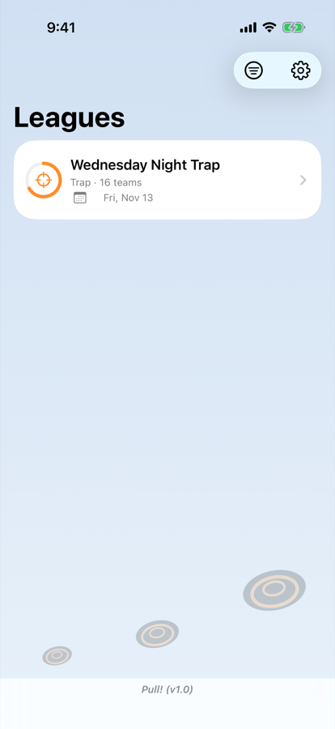</p>

Each league's row starts with an icon for what it is — a scope for trap, a target for skeet, a
trophy for a tournament — inside a ring that fills as the season's weeks are shot: orange for trap,
blue for skeet, purple for a tournament, and green once the last week is shot. Beside the name is
the date of the next shoot. A cancelled week does not count toward the ring.

**On an iPad**, tapping a league closes the Leagues list so the league has the whole screen. The
sidebar button at the top left brings the list back.

### Tidying the Leagues list

Seasons accumulate. To put a finished one out of the way without deleting it, swipe left on it in
the Leagues list and tap **Hide** — or press and hold the league and choose **Hide League**.

Hiding is **per device**. A league you hide on your phone is still there on your iPad, and nobody
else sees any change: the league keeps syncing, and you still get its notifications. Nothing is
deleted, and anyone you have shared it with is unaffected.

Hidden leagues collect in a **Hidden Leagues** row at the bottom of the list. Open it to see them,
tap one to look inside, or swipe left and tap **Unhide** to put it back. If you hide every league,
the Leagues screen says *All Leagues Hidden* with a link straight to that list — your leagues are
still there.

Anyone can hide a league on their own device; unlike deleting, it is not restricted to the secretary.

To narrow the list without hiding anything, tap the **filter** button at the top of the Leagues
list. It has three choices, and they combine:

- **All Leagues / My Leagues / Joined Leagues.** **My Leagues** are the ones you created or
  imported, where you are the secretary. **Joined Leagues** are the ones somebody else shared with
  you, including any where they made you a backup secretary.
- **Trap & Skeet / Trap / Skeet.**
- **All Formats / Seasons / Tournaments.**

The button fills in while a filter is on, so a short list never looks like missing leagues.
**Show All** clears it.

### The league screen at a glance

<p>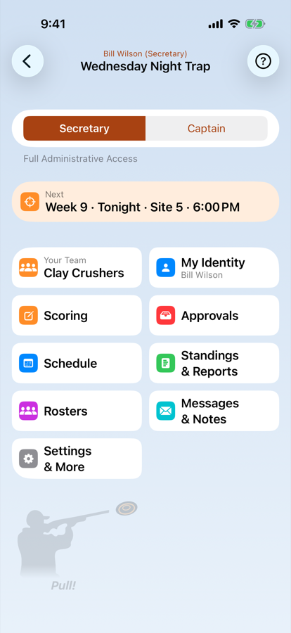 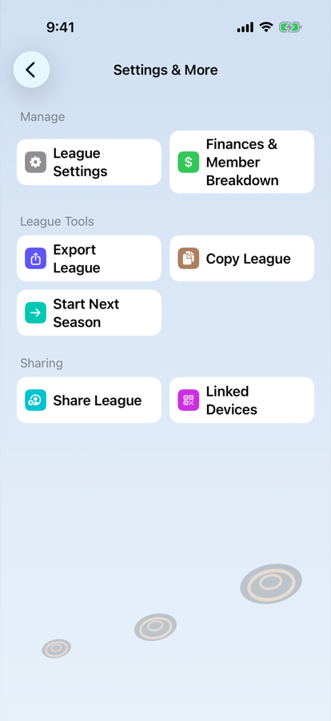</p>

Open a league and a summary sits above the buttons: what is next, and once this device is linked to your name, where your team or squad shoots and when (*Week 5 · Wed, Nov 18 · Site 3 · 6:00 PM*). It appears once the league has a schedule. Tap it to open the schedule at that week. Who is leading is on Reports.

Below it are the buttons, two to a row, each named for a job. You see only the ones you can use:

| Button | Who sees it | What it opens |
|---|---|---|
| **Your Team** | anyone linked to a member of a team | your own team; it leads the tiles |
| **My Identity** | every device that can do more than view | beside Your Team: where you pick your own name |
| **Scoring** | the secretary | the Match Data screen, to type or correct scores |
| **Approvals** | the secretary | score sheets and roster changes captains have sent, with a count |
| **Sheets on This Device** | anyone with a sheet not yet sent | the sheets this device has started |
| **Schedule** (**Events**) | everyone | the schedule. Before there is one, the secretary sets it up here |
| **Standings & Reports** | everyone, once there is a schedule | Standings, Results, Leaders and Awards |
| **Rosters** (**Squads**) | everyone | the teams, substitutes, **Participation**, and **Find a Member**, which searches everyone in the league |
| **Messages & Notes** | the secretary and the captains | the inbox of what the secretary has sent (the secretary writes from here too), and, switched at the top, your **Notes**. Anyone else who can do more than view gets **Notes** on its own |
| **Settings & More** | the secretary | Settings and Finances under **Manage**; **League Tools** (export, copy, next season); and **Sharing** for the owner |

A new message also shows as a banner at the top of the league screen.

Every tile's icon sits on its own colour, and a tile keeps that colour wherever it appears: Scoring is
orange, Schedule blue, Rosters purple, and **Your Team** wears your team's colour. On a shoot night
the **Next** tile turns orange and says **Tonight** (**Today** for a daytime start or a tournament). A member's
initials sit on their team's colour beside their name on rosters and the people lists, and a thin
strip of the team's colour runs under the top bar on a team's or a member's screen.

**Notes** are your own notebook for a league: a machine that jammed, a ruling, who still owes a fee.
Tap **New Note**, and choose which week it is about or leave it about the league as a whole. A note
stays on the device it was written on. It is not shared, synced or exported, and it goes if the
league is deleted from this device. Swipe a note to delete it.

<p>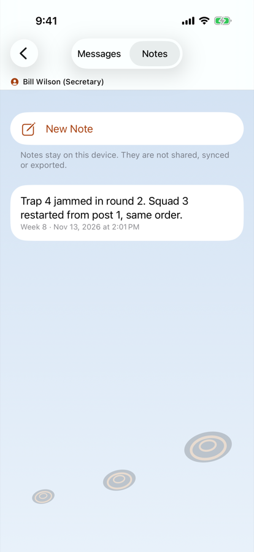 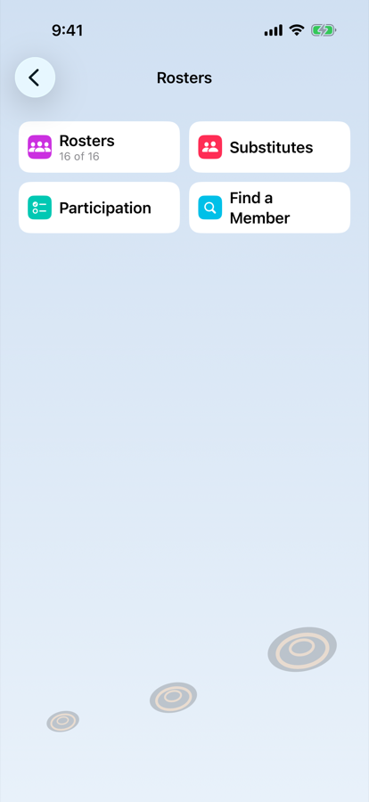</p>

### Trying the app without touching your data

**Demo Mode** loads a complete sample league — teams, rosters, a generated schedule, and a season of
scores — so you can explore every screen safely. It is **Try the Demo** on the empty Leagues screen,
or **Try Demo Mode** in the gear menu, where **Exit Demo Mode** takes you back out.

Demo data is kept in a **separate file** from your real leagues and never reaches iCloud. Leaving
demo mode deletes it and returns you to your own leagues. Nothing you do in demo mode can affect a
real season.

### Text size and VoiceOver

Pull! follows the text size you choose in iOS (**Settings** → **Display & Brightness** → **Text Size**,
or **Accessibility** → **Display & Text Size** → **Larger Text**). At the largest sizes some of the wider
tables, such as the standings and results, scroll sideways rather than shrinking the figures.

Pull! is **not designed for VoiceOver**, and VoiceOver is not supported.

---

## 2. Settings Reference

<p>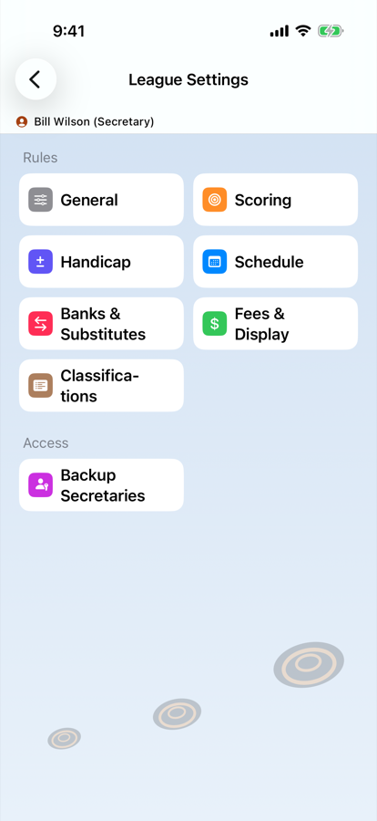</p>

All settings live under **Settings & More → League Settings** on the league screen, grouped into seven screens — **General**,
**Scoring**, **Handicap**, **Schedule**, **Banks & Substitutes**, **Fees & Display** and
**Classifications** — plus
**Backup Secretaries** for the owner. Everything here is secretary-only; captains and view-only
participants do not see the row.

### General

| Setting | What it does |
|---|---|
| **Type** | Trap or Skeet. Changes the shot-sheet layout (station count) but not the scoring rules — those are the numbers you set below. |
| **Match Type** | **League Ranking** or **Team vs Team**. See below. |
| **Rank Max Points** | *(League Ranking only)* Points to the top team each week. Second gets one fewer, and so on, floored at zero. |
| **Number of Teams** | The most teams the league can hold. Default 10. **Add Team** disappears once it is reached, so raise it before adding teams for a larger league. It also caps Rank Max Points. The scheduler uses the teams you have actually created. |
| **Roster Size** | Shooters per team, including empty slots. |
| **Shooting Weeks** | Season length, used by the scheduler. |

**Match Type is the most consequential setting in the app.**

- **League Ranking** — every team is ranked against the whole field each week and points are
  distributed from the top down (Rank Max Points, then one fewer per place, ties splitting).
- **Team vs Team** — teams are paired head-to-head. Each round is worth one point to whoever shoots
  higher, plus one more for the higher combined total. With 2 rounds per match, that is exactly
  **3 points on the table per match**, and the two sides always add up to 3. A tie at any of those
  splits that point 0.5 each.

The two modes store their weeks in shapes that are not interchangeable, so changing Match Type while
a schedule exists asks you to confirm and then takes you straight to the regenerate sheet. If you
close that sheet without generating, the setting reverts — the schedule and the setting always agree.

### Scoring

| Setting | What it does |
|---|---|
| **Rounds Per Match** | Rounds each shooter shoots per week. Default 2. |
| **Target Format** | What the league throws: **Singles** or **Doubles**, plus **Handicap (yardage)** for trap and **International (ISSF)** for skeet. Sets Max Round Score to the format's targets per round (50 for doubles). Fixed once scores are recorded. |
| **Max Round Score** | Perfect round. 25 for both trap and skeet. Also the handicap target and the cap ceiling. |
| **Valid Scores** | How many of a team's shooters count toward the team total **each round**. The highest N are kept; the rest are dropped. Can never exceed Roster Size. |
| **Tiebreakers** | How many of the *dropped* shooters are compared to break a tie. Can never exceed Roster Size − Valid Scores, or 5. |
| **Cap Scores at Max** | Clamps a handicap-adjusted round score at Max Round Score. On by default. |
| **Allow Dummy Score** | When a team is short-handed, repeats its lowest counting score to fill one missing slot. See below. On by default for Skeet. |

#### Allow Dummy Score, explained

**Valid Scores** says how many shooters count toward the team total each round — say 4. If only 3
of the team shot that round, the team is a score short and would lose to a full team on arithmetic
alone, regardless of how well those 3 shot.

**Allow Dummy Score** covers that gap. The team's *lowest counting score* for the round is repeated
once to fill the empty slot. So a team shooting 24, 22, 21 with Valid Scores of 4 is totalled as
**24 + 22 + 21 + 21 = 88** — the 21 counted twice.

Three things to know:

- It fills **exactly one** slot. If two shooters are missing, the team is still a score short. This
  is deliberate: the more shooters missing, the less a repeated score represents the team.
- It uses the **lowest** counting score, never the highest — it softens a shortage, it does not
  reward one.
- The repeated score is not credited to anyone. It belongs to the team total only and never touches
  a shooter's own record or average.

Turn it **off** if you want a short-handed team to carry the full penalty of being short.

### Handicap

| Setting | What it does |
|---|---|
| **Handicap Type** | **None** or **Avg**. |
| **Factor** | Percentage of the gap to the perfect score awarded as clays. Default 90%. |
| **Rounds in Average** | How many of the shooter's most recent rounds feed the average. Default 8. |
| **Use Starting Average** | Fills a shooter's average from the **Starting Average** on their member record until they have shot enough rounds of their own. |

Factor, Rounds in Average and Use Starting Average are shown only when Handicap Type is **Avg**.

The handicap formula is:

> **handicap = Factor% × (Max Round Score − handicap average)**

So a 90% league with a max of 25 gives a shooter averaging 20 a handicap of 0.9 × 5 = **4.5** clays
per round. Their 20 scores as 24.5. With **Cap Scores at Max** on, no adjusted score exceeds 25.

Two things to know before week 1:

- **Week 1 handicaps are self-referential for a member with no starting average.** With no prior
  week to average, their handicap for week 1 is computed from the very scores being adjusted. This compresses the field hard — a shooter who
  breaks 14 and 12 posts a handicap score around 24.8, while one who breaks 24 and 24 posts 24.9.
  This is how the original club software behaved and is preserved deliberately, but expect week 1 to
  be decided by rounding and the cap rather than by shooting.
- **Starting Average only helps if you set it.** Turn on **Use Starting Average**, then on each
  member — on the **New Member** screen, or later with **Edit** on their member screen — turn on
  **Has Starting Average** and enter the figure. Fractions are kept: 21.5 is spread across the
  week's rounds rather than rounded down. A member with a starting average is handicapped in week 1
  on that average **alone**, not on the scores they are shooting, and it keeps filling their
  average until they have shot **Rounds in Average** rounds of their own.

### Schedule

| Setting | What it does |
|---|---|
| **Flights** | Time slots per night. Flight 1 shoots, then Flight 2. |
| **Available Sites** | Fields/houses available. |
| **Starting Site** | Which site number the league's first field is. |
| **Flight Spacing** | Minutes between flight start times. |
| **Start Time** | First flight's start time, 24-hour. |
| **First Match** | *(Season Start — shown once a schedule exists)* The date of the first week. Changing it moves every week by the same amount, keeping the gaps between them. Fixed once any score is recorded; a single week can still be moved with **Cancel Week → Move to End of Schedule**. |

Flights and sites together give the weekly capacity — `sites × flights` shooting slots. A 16-team
league on 8 sites with 2 flights fills exactly, with nobody sitting out.

### Banks & Substitutes

| Setting | What it does |
|---|---|
| **Max Season Banks** | How many bank scores **one team** may use across the whole season. **Set to 0 to turn banking off entirely.** |
| **Max Weekly Banks** | How many bank scores **one team** may use in any single week. |
| **Allow Substitutes** | Whether substitutes may be used at all. |
| **Substitutes in Leaders** | Off, as it starts, the **Leaders** report lists rostered members only. On, substitutes are listed too, by the same rules as rostered members, with **(S)** after their name. **Most Improved** and the **Awards** report never include substitutes. |

> **Both caps count a whole team, not a member.** A team of five with Max Weekly Banks of 2 can bank
> two of its shooters in a week, whoever they are. When a limit is reached the Bank switch stops
> being available and says which limit stopped it — *weekly limit* or *season limit* — and a bank
> already switched on can always be switched back off. A third limit is natural rather than
> configured: each earlier score can be banked exactly once.

### Fees & Display

| Setting | What it does |
|---|---|
| **Member Fee** / **Guest Fee** | Season fee for club members and for everyone else. |
| **Show Roster Categories** | Splits the targets figures into **Club Members** and **Guests** — on the Results tab and at the end of the Roster PDF. |
| **Improvement Rounds** | How many opening rounds **Most Improved** and **Biggest Slump** measure a shooter's finishing average against. Default 4. |
| **One Award per Shooter** | Off, as it starts, a shooter wins every award they lead. On, a shooter can win only one. The awards are settled in the order the Awards report lists them: a shooter takes the first they lead, and each later award goes to the next in line. Each award still lists the shooter who leads it, with the award they already won, and then the top three of those still eligible: 1st wins, 2nd is next in line. Seasons only. |

### Classifications

The list offered beside each shooter, with **None**: Youth, Senior and Super Senior to start with.
Each league keeps its own, and **Start Next Season** and **Copy** carry it to the new one.

- **Add** — type a name under the list and tap **Add**.
- **Rename** — edit the name in place. Everyone who holds it keeps it under the new name.
- **Reorder** — drag the handle; pickers list them in this order.
- **Delete** — tap the red minus. If anyone holds it, you choose another classification to move them
  to, or None. The number beside a name is how many shooters hold it.
- **Restore Youth, Senior, Super Senior** puts the starting list back; anyone holding one you added is
  set to None.

A shooter added from another league keeps their classification only if this league has the same
one, which a copied or next season does. Otherwise they start at None.

### Access

**Backup Secretaries** — owner-only. Members promoted here get full secretary editing power on a
shared league. See [Section 14](#what-each-role-can-do). The screen lists only the people you have
chosen. Tap **Add Backup Secretary** to pick someone: captains are listed first, then the rest of the
rosters, then substitutes, and you can search by name. To take someone off, swipe left on their name
(or tap **Edit**). To make somebody who is not on a team a backup secretary (a club officer who helps
run the league, say), add them with **Substitutes → Add Substitute** first, then pick them here.
Moving a backup secretary to the substitutes keeps them on the list; only taking them off, or
deleting them, removes them.

### What locks when scores exist

Once **any** score is recorded in the league, these become read-only:

- **Match Type** — shown as plain text instead of a picker.
- **Roster Size** — shown as plain text instead of a stepper.
- **First Match** (the season start date) — fixed.
- **Regenerate Schedule**, **Import Schedule** and **Clear Schedule** — no longer available.
- **Delete Team** — a team cannot be deleted once scores have been recorded.

All of these are locked for the same reason: scores are stored against a week number and a roster slot,
so changing any of them would silently re-interpret weeks that have already been played and
published. **Clear Scores**, in **Scoring**'s **⋯** menu, is the deliberate way to unlock them, and
it does exactly what it says.

---

## 3. Teams, Members and Substitutes

### Add teams

On the league screen, tap **Rosters**, then **Add First Team** (later, **Add Team**). On the
**New Team** screen, enter the team name. **Display Number** defaults to the next free number and is
what appears on reports as "Team 3". You can type the roster in on the same screen — a name per
**Member** slot, with **Captain** and **Club Member** switches — then tap **Add**.

**Each team has a colour**: a dot beside its name on the schedule, the standings and the team's own
screen, and a stripe down its card on the Results tab. Pull! hands them out in team-number order. To
choose one, open the team, tap **Edit**, and pick a **Colour**; **Automatic** goes back to the one
Pull! chose. The colour syncs with the league, so everyone sees the same one.

### Add members and build rosters

1. In **Rosters**, tap the **Rosters** row (it shows how many teams you have, e.g. *Rosters (8/10)*).
   It opens the first team; **Previous** / **Next** page through the others.
   Captains and backup secretaries who have picked their name also get a **Your Team**
   button at the top of the league screen, which opens their own team.
2. While the team has an open slot, tap **Add Member**, then either pick someone from **Available
   Substitutes** or tap **Create New Member**.
3. Repeat for each team.

**Edit** on a team lets you rename it, change its display number, drag the shooting order (the
captain always stays first), **Remove Member**, or **Delete Team** (only before any scores exist).

A roster keeps **fixed slot positions**. Removing someone leaves their slot vacant rather than
shuffling everyone up, so shooting order stays stable and the next person added takes the empty
place.

To designate a captain, open the member, tap **Edit**, and turn **Captain** on — the previous
captain is replaced. A team always has a captain, so the switch cannot be turned off on the only
one; make someone else captain instead. Captains are the only members who can submit scorekeeper
sheets, and they are the only ones who see the scorekeeper banner. The captain is kept at the top of
their team's roster automatically.

**A member's screen** — tap them on a roster — shows their scores and season figures. Once they have
shot two nights it also draws an **Average Trend**: their raw average after each night, with the
change since the first night beside it. **Highlights** collects their straights, their best night,
and their longest run of rounds within two targets of a straight. A sub's screen shows the same. A
tournament shows Highlights but no Average Trend, and counts each event against its own format: a
straight in Doubles is a 50.

**A straight gets a gold burst** wherever its score is shown: beside the round on **Results** and
**Team Scores**, as a gold bar on a member's score chart, in **Highlights**, which also names the
week of their first, and in the score box the moment it is typed. A bank score is a copy and never
gets one. In score entry a banked shooter's row is tinted orange.

Below the figures, **Details** says who the member is: classification, sex, captain, club member,
and their starting average if they have one. The secretary, and the captain of the member's team,
also see their email and phone (tap either to write or call), and the secretary sees **Fee Paid**
and the ATA / NSSA number. To change any of it, tap **Edit**.

**Team Scores**, on a team's screen, shows the team one week at a time; **Previous** and **Next**
page through the season. Tap a shooter to open their screen — on a slot a sub covered, the sub's,
since those are the scores shown. Under the shooters, **Points** is what the team took from the
week, the same figure as the standings' weekly points; tap it to open that week on the **Results**
tab.

### Substitutes

Members who are not on any team live in the league's **Substitutes** pool. Open **Substitutes** from
the league screen to see the subs, sorted by last name, each row showing how many rounds that sub
has actually shot this season. Once the season has scores, the list opens on **This Season** — only
the subs who have shot a round, the same people the roster sheet prints — and **Everyone** at the top
shows the whole pool, including names carried over from an earlier season who have not shot yet.
Before the first night it simply lists everyone. Tap a sub for their scores, season stats, and the
weeks they filled in.

**Adding a sub** (secretary only): tap **Add Substitute** at the top of the list. It takes the same
details as a new team member, without Captain, and puts them in the pool on no team and in no lineup.
The secretary sees **Substitutes** under **Rosters** even before the pool has anyone in it, so the
first sub can be added there. A sub can also be added on the night, with **New Sub** in a lineup slot.

A substitute:

- can shoot for any team, in any week, in place of an absent rostered member;
- keeps their own scoring record, and their rounds count toward their own average;
- **cannot use a bank score** — a bank stands in for a rostered member's missed week, and a sub is
  the stand-in, so **Bank** is unavailable for a slot with a sub in it;
- cannot be a captain, and **cannot hold an identity** unless the owner makes them a backup
  secretary in [Settings → Access](#access).

Promoting a sub onto a team roster is simply adding them to the team — their history stays with them.

**Deleting a sub** added by mistake, or one who never came: open them and tap **Delete Substitute**
(secretary only). It is offered only for somebody the season has no record of — no scores, no week
covered, not in a played week's lineup, not on a score sheet — so nothing already printed changes.
To delete someone on a team, remove them from the team first; they move to the pool.

**Merging a sub entered twice.** A sub typed in under two spellings ends up with their scores split
across two people, and both averages are wrong. Open the misspelled one, tap **Merge Into…**
(secretary only) and pick who they really are. The closest names are listed first, but nothing is
merged until you choose and confirm. Their scores, the weeks they covered and any linked device move
to the person you picked, whose name and details are kept, and the misspelled sub is removed.
A merge can't be undone, and it is refused, with the reason shown, when:

- both of them are recorded in the same week, so one of them is wrong about that night. Clear the
  wrong week first;
- a score sheet naming the misspelled sub hasn't been approved yet;
- a roster change for them is waiting for review.

With more than one secretary device, merge on one of them while nobody is entering scores on another.
If this device has changes iCloud hasn't taken yet, **Merge Into…** asks you to tap **Sync Now** first.

### Removing someone mid-season

Open the team, tap **Edit**, then **Remove Member**. Removing the captain asks you to **Choose a
Captain** first, and a captain who is the team's only member cannot be removed until someone else is
added. A removed member also loses any open scorekeeping jobs and their backup-secretary listing.

Removing a member from a team leaves their slot vacant and moves them to the substitutes pool. **It
does not change any week that has already been scored**, and it does not delete their scores — see
[Section 9](#what-happens-to-past-weeks) for exactly why.

There is currently no way to delete a member from the league entirely. Benching them into the
substitutes pool is the supported route.

---

## 4. Building the Schedule

You have two ways to get a season into the app: let it build one, or import one you already have.

### Option A — Generate a schedule

From the league screen, tap **Schedule → Generate Schedule**. Enter a start date, choose
whether to **Use Bye Weeks**, and tap **Generate**. The sheet shows the league settings it is about
to use — weeks, teams, flights, sites, starting site, match type — so you can check them first.

Generation is deterministic: the same settings and start date always produce the same season. The
scheduler balances each team's use of sites and flights as evenly as the arithmetic allows, and in
Team vs Team mode pairs opponents with a round-robin. How it does each of those is below.

### How a generated schedule is built

The schedule is built one week at a time, each week one week after the last, starting on the date you
enter. Each week is decided in three steps.

**1. Who sits out.** If **Use Bye Weeks** is on and the teams don't divide evenly into the week's
shooting slots, some teams sit out — see *Bye weeks, ghosts, and delegates* below. Byes are worked out
for the whole season before any week is built, so every team gets the same number.

**2. Who plays whom** *(Team vs Team only)*. Opponents come from a round-robin: one team stays put and
the rest move round one place a week, so in a season without byes every team meets every other
once before anyone meets the same opponent twice. A season longer than that starts the cycle again.
If a team's opponent that week is on a bye, the teams left without a partner are paired with each
other, which can bring a repeat round sooner. A League Ranking
season skips this step — every team is ranked against the whole league, so there are no opponents.

**3. Where each team shoots.** Every playing team gets its **own** site and flight for the night. The
app spreads each team across the sites and flights over the season: a team that has already shot a
site or a flight is steered elsewhere, and the more often it has been somewhere, the harder it is
steered away. Opponents are not placed together — a matchup records who plays whom, not where, so two
opponents may shoot on different sites or in different flights.

The app tries many seasons this way and keeps the most even one, judged first by the **worst-served
team** — a season where one team keeps returning to the same site is worse than one where everybody
is slightly uneven. A 16-team league on 8 sites with 2 flights over 12 weeks comes out with every
team in each flight exactly six times, and on no site more than once more than any other.

**Short weeks.** When fewer teams play than there are slots, the empty slots are taken as **whole
sites** before any site is left half used. Scorekeeping pairs the two teams on a site — one in each
flight, each keeping score for the other — so a half-used site leaves a team with nobody to keep its
score. Which sites stand empty moves from week to week, so the idle fields are not always the same
ones.

**A worked example: 13 teams, 8 sites, 2 flights, 11 weeks.** There are 16 slots, so three are always
spare.

- **Use Bye Weeks on:** one team sits out each week, leaving 12 to play — six full sites, two sites
  empty, nobody alone on a site, and in Team vs Team six matchups with nobody left over. Eleven weeks
  of one bye would give 11 byes for 13 teams, which can't be shared evenly, so one week sits out three
  teams instead: 13 byes, **exactly one per team**. That week 10 play on five full sites.
- **Use Bye Weeks off:** all 13 play every week. One site stands empty and one site has a team in only
  one flight, so that team needs a **delegate** scorer, marked **X** on the grid. In Team vs Team the
  odd team out also plays a **ghost** each week. Who lends their scores to the ghost rotates, going to
  whichever team has done it least.

If the teams don't fit at all — more teams than sites × flights with byes off — the app says so
instead of building a season, and asks you to turn on Use Bye Weeks or add sites or flights.

**Changing the settings later.** Regenerating builds a whole new season from the current teams and
settings and replaces every week. It isn't available once any score is recorded — see
*Regenerating the schedule* in section 11.

### Option B — Import a schedule

If your season was built elsewhere and already handed out to members, generating a new one is not
equivalent — it produces a *different* season from the one people are holding. Import it instead.

With no schedule yet, tap **Import Schedule** under **Generate Schedule** on the Schedule screen. To replace
an existing schedule, use **Import Schedule** in the Schedule screen's **"…"** menu. Tap **Choose
File…** and pick a CSV file with one row per team per week:

```
Week,Flight,Field,Team
1,1,1,Scatter Guns
1,1,2,Organized Chaos
1,2,1,Clay Crushers
```

- **Week**, **Flight** and **Field** all count from 1, matching what is printed on your sheet.
- **Team** may be the team's name or its number in the roster order. Name matching ignores case,
  extra spaces, and the curly apostrophes a spreadsheet substitutes.
- An optional **Date** column (`2026-09-09` or `9/9/2026`) overrides the start date, which is useful
  when a season skips a week for a holiday.

The app validates the whole file before changing anything. When it finds a problem it lists every
row with that same problem in one message — unknown team names, a field or flight beyond your
Available Sites or Flights setting, a team placed twice in one week, two teams on the same field and
flight, or a gap in the week numbers. Fix them and choose the file again.

A file that passes shows a preview before you commit: the week, team and placement counts, any
warnings under **Check These**, and week 1 listed flight by flight and field by field. If the file
has no Date column, set **First Match** there; weeks are then dated one week apart.

Two limits worth knowing:

- **Import is League Ranking only.** A placement file records who shoots where, not who plays whom,
  so there is nothing to build head-to-head pairings from. The menu item does not appear in a Team
  vs Team league.
- **Import replaces the whole schedule** and, like Regenerate, is unavailable once scores exist.

Teams sitting out a week are worked out from who is *absent* from that week's rows, so the bye list
can never disagree with the placements.

### Bye weeks, ghosts, and delegates

Three things can happen when the number of teams doesn't divide evenly into the shooting slots, and
which one you get depends on **Use Bye Weeks**.

With **Use Bye Weeks on** — the recommended setting — the schedule sits enough teams out each week
to make the rest divide evenly. A 13-team league on 8 sites plays 12 teams a week: six full sites,
six matchups, nobody left over. Byes are planned across the whole season up front and dealt in
rotation, so every team sits out the same number of times, and no team sits out two weeks running
unless more than half the league byes in a week.

With **Use Bye Weeks off**, everybody plays every week, and the leftovers have to be absorbed:

- A **ghost** is a bye that still gets played. In a Team vs Team league with an odd number of teams,
  one team has no opponent, so it plays a ghost — a stand-in whose scores are copied from another
  team that week. Your result against it counts normally. The team whose scores were borrowed gains
  nothing from it; their own match is separate and unaffected.
- A **delegate** is a second scorer. If a site ends up with a team in one flight and nobody in the
  other, that team has nobody to keep its score, so another team supplies someone.

Turning byes on removes both. Turning them off is what brings them back.

### Adding the schedule to your calendar

Anyone with the league, captains included, can put its nights in the phone's Calendar: open the
schedule (**Schedule** on the league screen) and tap the **calendar** button at the top right. The first
time, iOS asks whether Pull! may add to your calendar. Pull! only adds; it never reads your calendar.

Every night still to come is added, at the league's start time and blocked out for two hours,
named for the league and the week. Past and cancelled nights are left out.

**Calendar does not follow later changes.** A night moved or cancelled afterwards stays as it was
in Calendar, so edit or delete it there. Tapping the button again adds a second copy of every
night, so Pull! asks first if this device has added the schedule before.

### Reading the schedule grid

Every week opens with a table: one row per site, one column per flight. In a Team vs Team league a
**Matchups** list under it shows who plays whom. Flights are time slots — Flight 1 shoots, then Flight 2 — so the two teams on a site keep score for each
other, and neither is on the line when it does.

When the number of teams playing doesn't divide evenly by the number of flights, one team is left on
a site with nobody opposite. The schedule fills sites completely before splitting one, so there is
never more than one such site in a week.

| Mark | Meaning |
|---|---|
| **X** | This slot is empty **and** the site holds a team with no opposite-flight partner. Somebody has to be sent to keep score at this site. |
| **(X)** | This team supplies that scorer. |

Sites nobody is shooting on that week are left out of the table.

**(X)** and the note under the table naming both teams appear once scorekeepers are assigned for the
week; until then the note asks you to assign them.

The team marked **(X)** is already keeping score for its own site partner at that time, so its
captain can't be in both places — that team sends a delegate. Duty rotates: the team that has
supplied the fewest scorers so far is picked next, so over a season it spreads across the league.

### Assigning scorekeepers

From the schedule view's **"…"** menu, tap **Assign Scorekeepers** and pick a captain for each team's
sheet. The app proposes the natural site pairing — the two teams sharing a field across flights keep
score for each other — and you can override it.

Assigning is unavailable on a cancelled week or one that already has scores.

Once saved, each named captain gets a notification and sees a **"You're scorekeeping"** banner on
their league screen (in Captain mode). While some teams still have no scorekeeper the menu offers **Assign Remaining
Scorekeepers**, and once every team has one it offers **Edit Scorekeepers**, to swap a captain without
clearing the week; a newly named captain is notified. A replaced captain loses the week from their
league screen, but a sheet they already started stays on their phone under **Sheets on This Device**.
Once anyone is assigned the menu also offers **Remove Scorers**, which clears that week's
assignments and nothing else — it works on a week that already has scores, too.

---

## 5. Starting a New Season

Most clubs run the same league again with mostly the same people. **Start Next Season** does that
in one step, and keeps each shooter's history linked from one season to the next.

On the league screen, tap **Settings & More → Start Next Season** (it is there only in Secretary mode, and not
for a tournament). The name pre-fills with the year moved on — *Fall League 2026* becomes
*Fall League 2027*.

### Choosing who comes back

Every team's roster is listed, then the substitutes, all ticked. **Untick anyone who is not
returning.** Somebody left behind is taken off their team, the substitutes pool and the
backup-secretary list; if that was a team's captain, choose a new one afterwards.

Beside each returning shooter is their **classification**. Check it: a shooter who has become a
Senior over the winter is changed here, and the change applies to the new season only — last
season keeps what it recorded.

**Start From This Season's Averages** (on by default) gives everyone coming back who shot at least
four rounds this season's average as their starting average, and turns on Use Starting Average, so
their handicap has something to work from on the first night.

**Four rounds means four they actually shot.** Bank scores, rounds they did not finish (DNF) and
cancelled weeks do not count, the same as for any average. In a two-round league that is two nights.
**Anyone with fewer gets no starting average**, most often a substitute who filled in once: one
night is too little to set a handicap on. Until they have shot rounds of their own in the new
season, their first night is handicapped like any new member's (see
[Two things to know before week 1](#handicap)). If you know what they shoot, give them one yourself:
open the member → **Edit** → turn on **Has Starting Average** and enter the figure.

### What carries over, and what does not

| Carries over | Starts fresh |
|---|---|
| Every team — name, number, captain, roster (less anyone leaving) | Scores |
| Every returning member — name, contact details, flags, sex, classification | The schedule — you build a new one |
| The substitutes pool and backup-secretary list | Fee Paid — everyone starts **unpaid** |
| The complete rule set — every setting from Section 2 | Score sheets, roster-change requests, captain messages |
| | Weekly substitute records, per-week rosters, scorekeeper assignments |

### Nuances worth knowing

- **You will need a new schedule.** The new season has none. Generate one, or import the one you
  have already published ([Section 4](#option-b--import-a-schedule)).
- **The new season is private and unshared.** It does not inherit the previous season's iCloud share, so
  captains will not see it until you share the new league and they accept. That is deliberate — you
  almost never want last season's participant list applied silently to this season.
- **Linked devices are not copied.** Once you share the new league, each captain picks their name
  again and you scan their device on **Linked Devices**.
- **Names must be unique.** The copy is refused if a league with that name already exists.

### Copy is for an exact duplicate

**Copy League**, also under **Settings & More**, makes an exact duplicate of the league — scores, schedule, fees paid and
all — named with `-COPY`. Use it for a backup, or a copy to try something on without touching the
real season; use Start Next Season for a new season.

### Recommended new-season sequence

1. **Start Next Season** — untick leavers, check classifications.
2. Open **Settings** and check Match Type, Roster Size, Valid Scores, handicap, fees, and bank
   settings.
3. Add newcomers and update captains.
4. Generate or import the schedule.
5. Share the league with this season's captains.

---

## 6. Identity — Linking Your Device

"Identity" is the way each device knows who is using it. It is a per-device, per-league setting.

### Linking your device

**A captain's device takes a name only when the secretary links it, in person.** Bring your phone
to the kickoff meeting or the first night:

1. Accept the league invitation, if you have not yet (Section 14).
2. On the league screen, tap **My Identity**, and tap your name. Your device
   shows a code under **Link This Device**.
3. Show the code to the secretary. They scan it in Pull! (**Linked Devices** → **Link a Device**).
4. Your device takes the name the next time it syncs. **Check Now** on the code screen syncs at once.

Until then your device acts as nobody in the league. It can read everything, but it has no captain's
name and no captain's permissions. A code works for 10 minutes; the screen makes a fresh one while it
is open.

The line above the league's name shows who this device is acting as — your name, or **Identity Not
Set**.

**A second device, or a new one.** Each phone or iPad is linked on its own: pick your name on it and
the secretary scans it, and your other devices keep their links. A reinstalled Pull! counts as a new
device, so it needs scanning again.

Choosing **Not Set** yourself is a deliberate choice, and the app leaves it alone — it will not put
your name back on its own. Picking your name again and showing the code lifts it.

The secretary's own devices need no link: owning the league is the proof. They pick their name and
take it at once.

That is the whole of it. Your name then appears in the identity header at the top of most screens,
and the app uses it to route scorekeeper assignments to the right captain and to decide what you can
edit.

**Only captains and backup secretaries pick a name.** Those are the only roles a name gives you
anything for — scorekeeping, score sheets, edit requests, the secretary's tools — so the picker lists
only them. Everyone else reads the league without picking one, and the secretary has sixteen
devices to scan in a sixteen-team league rather than eighty. A substitute is listed only if they are
a backup secretary.

**A name is only kept while you hold the role.** If you stop being a captain or a backup secretary —
replaced as captain, taken off the backup-secretary list, or (as a captain who is not a backup
secretary) moved to the substitutes — the
secretary's next save unlinks your devices, and yours shows an **Identity Changed** alert. Made
captain later, you are linked the same way as any captain.

**A name also goes when your access does.** If your device ends up view only, it stops acting as you
until you have Can Edit again. If the secretary stops sharing the league, you lose the league and your
link, so you need a new invitation and a new scan. See
[What each action removes](#what-each-action-removes).

There is no acting captain: if a captain cannot make a night, whoever stands in keeps score on paper
and the secretary enters it.

> **Why in person, and why there is no PIN.** The app used to ask for a 4-digit PIN here, and later
> let a captain pick a name for the secretary to approve from a request. Both are gone. A copy of
> every PIN had to sit on every participant's device, which is a poor way to protect a four-digit
> number; and a request told the secretary nothing about who had sent it. Scanning the code on the
> phone in front of you does. A secretary who never scans a device has given nobody a captain's name.

### Secretary / Captain mode toggle

If you are the secretary (you created the league) or a backup secretary, and you are also a captain,
a **Secretary / Captain** toggle appears at the top of the league screen. Switch to Captain
to see the app exactly as your captains see it — useful for confirming the gating is working
correctly.

Switching to Captain mode does not reduce what your device is allowed to *sync*; it changes what the
app shows you. In Captain mode the secretary's tools are hidden — **Scoring** (with **Clear Scores**) and **Settings & More**
among them, though **Messages & Notes** stays — so switch back to
Secretary to use them. The scorekeeper banner, by contrast, shows only in Captain mode. Deleting a league
you created works in either mode: swipe it on the league list.

---

## 7. How Scoring Works

This section explains what the app does with a score once it is entered. You can run a season
without reading it, but every number on the reports comes from here.

### From a raw score to a team total

1. **The raw score** is what the shooter broke — 0 to Max Round Score, per round.
2. **The handicap is added.** With Handicap Type set to Avg, each shooter gets
   `Factor% × (Max Round Score − their handicap average)` clays per round. With **Cap Scores at
   Max** on, the result is clamped at Max Round Score.
3. **The team keeps its best scores.** For each round, the highest **Valid Scores** adjusted scores
   count toward the team total and the rest are dropped. On reports the dropped ones appear in red
   with a strikethrough.
4. **Short-handed teams may be filled.** With **Allow Dummy Score** on, a team with fewer shooters
   than Valid Scores has its lowest counting score duplicated once — only one missing slot is
   filled.
5. **The week's points are awarded** — by rank against the whole field, or head-to-head against one
   opponent, depending on Match Type.

### The handicap average

The average behind the handicap uses the shooter's most recent **Rounds in Average** rounds, taken in
the order the weeks were actually *played* — so a week moved to the end of the schedule counts in its
new position, not its old one. Banked scores are excluded; they are copies of rounds already counted.
So are cancelled weeks and DNF rounds.

Only weeks **before** the one being scored count, so a shooter's handicap is known before they step
up and never moves while their own scores are typed in.

If a shooter has no earlier rounds, their current week's scores are used (see the week-1 note in
[Section 2](#handicap)) — unless **Use Starting Average** is on and they have one, in which case the
starting average alone is used and this week's scores are not mixed in.

### Ties

With **Tiebreakers** set to 0, tied teams simply split the points available. With tiebreakers
enabled, the first tiebreaker is the team's best *dropped* shooter, compared on their total across
the rounds they shot that week; if still tied, the next-best dropped shooter, and so on. If every
tiebreaker slot is exhausted and the teams are still level, the team with **more shooters present**
wins — a banked score does not count as present, because the member did not actually shoot.

In a Team vs Team league, if the two teams' combined totals are still level after all of that, the
combined-total point goes to the team that won more rounds, and is split only if that is equal too.

### Bank scores

A **bank** lets a shooter who misses a week reuse one of their **earlier** weeks' scores for it.

- Each earlier score can be banked **once**. Using it marks it spent, and the app hands out the
  oldest eligible score first.
- A banked week counts toward the **team's** total for that week, exactly like a shot round.
- A banked week does **not** count toward the shooter's own average, rounds-shot count, or
  handicap — it is a copy of a round already counted once.
- Switching a bank back off releases the source score, so it becomes available again.

The **Bank** toggle sits next to each shooter on the score-entry screen. It is disabled when the
shooter has no earlier score left to bank, when the team has reached its weekly or season bank
limit, or for a substitute, and a short reason is shown beside it — **none** (**none available** on
a team's week editor), **weekly limit**, **season limit** or **sub**. Substitutes cannot bank, and a
slot with a substitute in it cannot also be banked. Once a shooter is banked,
their rounds show the copied score in an orange dashed box marked **Bank**, which cannot be typed in —
the keypad's Next and Back skip it. To change a banked week, switch the bank off. Each member's remaining
and used banks appear on their member card and in the Member Stats report.

**Who Should Bank?** On a team's screen, under **Team Scores**, this works out who should bank when
more shooters are out than there are subs to cover them. Tick who isn't coming and set how many
subs are available. The shooters whose bank plus that week's handicap scores highest are told to
**use bank**, and the rest **sub**. If the team's bank limits leave anyone with neither, they're
shown as **not covered**. When there are enough subs for everyone, nobody needs a bank. It opens on
the next week to shoot; the week bar at the top picks a later one. The screen
saves nothing: you still switch the banks on when scores are entered. It only appears in leagues
with banking on.

> Banking is on by default. To turn it off for the league, set **Max Season Banks to 0** in
> Settings → Banks & Substitutes. Both limits are enforced per team — see
> [Section 2](#banks--substitutes).

### Substitutes in scoring

When a substitute shoots for an absent rostered member, the sub's score counts toward the **team's**
total for that week in the absent member's slot, and toward the **substitute's own** record and
average. The rostered member gets nothing for that week, which is correct — they did not shoot.

### What a bye looks like

A team that did not play a week — a bye, or simply a week with no scores entered yet — shows **BYE**
on the standings rather than a zero. A zero is a score a team earned; a bye is not.

### Forfeited rounds

A team that cannot shoot a round forfeits it. At the top of the team's card in **Match Data**, above
the first shooter, the **Forfeit** row has a button per round — **R1**, **R2** and so on. Tap the
round's button; if scores are already entered for it, confirm with **Forfeit and clear**.

A forfeited round is *void*, not lost nil–all:

- **No score counts for anyone on that team for that round**, substitutes included. If scores had
  already been entered they are removed, and the app asks before doing that.
- The **opposing team takes the round**, and the forfeiting team scores nothing for it.
- It shows as **FFT** on screen and in the PDF, never as a `0`. A zero would say they turned up and
  broke nothing.

Forfeits are per round, so a team that arrives too late for round 1 can still shoot round 2 normally.

Tapping the same round button again clears the forfeit and reopens the round for entry. The scores it removed do not
come back — they were deleted — so you retype them.

### A shooter who does not finish

If someone starts a round and leaves part-way through, mark the round **DNF** — beside the score on
the entry screens, or beside the shooter's name on the captain's shot sheet. It turns orange when on.

- The targets they **did** break still count toward the team's total for that round. They were
  broken.
- The round is **excluded from that shooter's averages**, raw and handicap alike. A part-round is
  not a fair measure of anyone.
- A week containing a DNF **cannot be used as a bank** later, because there is no complete round in
  it to replay.

Marking DNF is also what lets a captain submit a shot sheet at all when somebody walks off — without
it the sheet waits forever for shots that will never be taken.

Clearing DNF puts the round straight back into that shooter's averages. Unlike a forfeit, nothing is
deleted — the score was only being ignored.

### A shooter who does not turn up

**Do nothing.** Leave their scores blank.

This is *not* a DNF. DNF means someone started a round and left part-way through, and it says the
targets they broke should count for the team. A shooter who never appeared has nothing to count.

Leaving the row blank is what records the absence:

- No score is saved for them, so their season average is untouched — they are not carrying a zero.
- The team is scored on the shooters it had.
- If your league uses **Allow Dummy Score**, one empty slot is filled by repeating the team's lowest
  score that round. Note it fills **one** slot: if two shooters are missing, the team is still a
  score short.

The same applies when a rostered member is out and no substitute could be found. Blank is the
answer; there is no button to press.

On a **captain's score sheet**, tap the shooter's name in Round 1's setup and choose **Absent**.
They drop out of the rotation (and out of Totals Only), the sheet submits without them, and approval
records nothing for them — the same as leaving them blank here.

### Half-entered weeks

A head-to-head week is only scored once **both** teams are resolved for every round — each side
either has scores or has forfeited. Until then both teams show **BYE** and neither takes a win or a
loss. This matters if you enter one team on match night and the other the next morning: in between,
the standings will not show a phantom result against the team you have not typed in yet.

---

## 8. Running a Match Week

### The life of a week

A week moves through these states, and it is worth knowing where the boundaries are:

1. **Scheduled** — dates, sites and flights are set. Rosters are still live: any roster change you
   make is reflected in this week.
2. **Scorekeepers assigned** *(optional)* — named captains are notified.
3. **First score entered** — **the week's roster is frozen at this moment.** From here on, this week
   is scored against the roster as it stood tonight, no matter how the team changes later.
4. **Scored** — all scores in. Reports and standings include it.

Step 3 is the one that matters most and is invisible while it happens. See
[Section 9](#what-happens-to-past-weeks).

### The scorekeeper banner

A captain who has been assigned to keep score will see a banner on the league screen titled
**"You're scorekeeping"** with the team name, the week, and the site and start time to go to — one for each assignment whose team has no
scores and no submitted sheet yet. It shows only in Captain mode, so a secretary who is also a
captain must switch to Captain to see it. The team named is the one
you are keeping score **for** — never your own. Tap it to open the scorekeeper sheet.

The banner goes away once that team's week is done: when you submit the sheet, or when the secretary
enters that team's scores by hand instead. If the secretary later clears those scores, the job comes
back to you. **A sheet you have already started keeps its banner** even after the secretary enters
scores, so your work is never stranded; the banner says the secretary has scores in, and if you
submit, approving your sheet replaces their scores for the shooters and rounds it holds.

**Sheets on This Device.** Every sheet you start stays on this device until you submit it. To see
them, open **Sheets on This Device** on the league screen (it shows only when there is one). Tap one to
carry on with it, or swipe left and tap **Delete** to throw it away. Nobody else ever sees these, and
a sheet sent back to you by the secretary is not listed: it has its banner.

### Filling in the scorekeeper sheet

The sheet walks through the round in three stages:

**Pre-round setup** — confirm the roster for this round. You can mark a shooter as banking their
score (they sit out and use a saved score), swap in a substitute with **Sub**, or tap their name
and choose **Absent** for somebody who did not turn up. If the person
standing in is not in the sub list, choose **New Sub** and type their full name: they are added to
the league's substitutes when the secretary approves the sheet, and their scores go to them. If
two sheets name the same newcomer for different teams, the second cannot be approved: the review
screen says the person is already shooting for another team, and the secretary rejects it or enters
that team's week by hand.

**To match the squad's order on the paper, tap Reorder** on Round 1's setup, drag the shooters, then
tap **Done**. Every round follows. Do it before the first shot: the order sets which station each
shooter starts at, so it locks once a shot is recorded. If you notice too late, **⋯ → Clear Scores**
empties the sheet (subs and banks too) and unlocks it. The order is for this sheet only: approving
it records the scores and **does not change the team's roster**. The secretary's review screen says
when the sheet was shot in a different order, so they can change the roster themselves if the team
wants it kept.

**Rotation entry** — the app steps through each rotation (station) one at a time. Tap each cell to
record whether the shot hit or missed: once for a hit, twice for a miss, a third time to clear it. The
large number at the right of each shooter's row is their hits **at this station** — the number to call
out as the squad rotates, so nobody has to count ticks — and **Rd** beneath it is their round so far.
The next shot to record is ringed in **yellow** — both boxes of a pair in doubles — and that shooter's
name is in **bold**, so you can find your place at a glance. On trap, the lead shooter's last box at each post
reads **Ready**: once it is shot, call Ready for the move to the next post.
At skeet station 8 the sheet takes either order: the whole squad's high house first and then each
shooter's low house, as the NSSA rules have it, or each shooter's high and low in turn, as many clubs
shoot it casually. The yellow ring starts on the NSSA order and follows yours as soon as you mark a
shooter's low house before the next shooter's high house.
On a skeet sheet each box names its house — **H** or **L** — and a pair's two boxes sit together, first
target first.

**The option (skeet singles).** The 25th target is recorded in the last box at station 8, labelled
**Option**. A shooter fires it straight after their first miss, so at every other station each shooter's
row ends with their own **Option** box: record it there without leaving the station. The box is ringed in
orange once they have missed and their option is still to come. The box cannot be tapped before their first miss, and
once their option is recorded you can still change it until you tap **Confirm Station**; after that it is
locked. When the option is the next shot, its ring is orange rather than yellow. **Until an owed option
is recorded, no other box can be marked** — for that shooter or the next — since the option is shot
immediately; boxes already marked can still be changed. It is the
same box as station 8's, so it shows in both places; a shooter still straight takes it at low 8 as
usual. If a miss is later ruled a dead target and changed, and the shooter has no other miss, the app
clears their option (and station 8's confirmation): they shoot it again at low 8, and the sheet waits for
it. Tapping that box on round to a miss again puts the option back, so one tap too many does not
lose it. Skeet doubles and International have no option.

You do not have to fill every station before moving on; the app saves your progress as you go and
will let you go back. **Review and Submit** becomes available once every shot in every round has
been recorded (a shooter marked **DNF** is exempt). If you switch the sheet to **Totals
Only**, each shooter's round total is typed on the app's own number pad, which carries **Back** and
**Next** beside the digits.

**Review** — a summary grid showing all shots for all shooters. Check the totals, then tap
**Submit to Secretary**. The sheet is sent to the secretary under the name linked to this device.

If you need to stop mid-sheet, tap **Close** — the draft is saved and will be waiting the next time
you open the assignment.

A shooter who did not turn up: tap their name in Round 1's setup and choose **Absent** — do not
record misses. They sit out every round, take no sub or bank, and get no score for the week; choose
**Shooting** to undo it before any of their shots are recorded. A shooter who genuinely missed every
target is different: record the misses, and a real zero is stored.

### What happens after you submit

The secretary sees a count on the **Approvals** button on the league screen, and beside **Score Sheets**
inside it. Each sheet waiting is marked with a blue **Waiting** tag. They open it, review the sheet, and either:

- **Approve** — round totals are posted to each member's scoring record.
- **Reject** — the sheet is sent back with an optional note. A rejected sheet re-opens in the
  scorekeeper view so you can correct and resubmit.

Any number of captains can submit at once — each sheet travels on its own and none can overwrite
another. **Approving is different:** it writes the scores into the league, so on a night with several
sheets to approve, approve them all on **one** secretary device (see *Using more than one secretary
device* in Section 14).

**The captain whose sheet was approved** sees a green **Score sheet approved** row at the top of the
league screen for three days afterwards, naming the team and the week. Tap the **×** to hide it until you next open the league.

### Direct entry by the secretary

<p>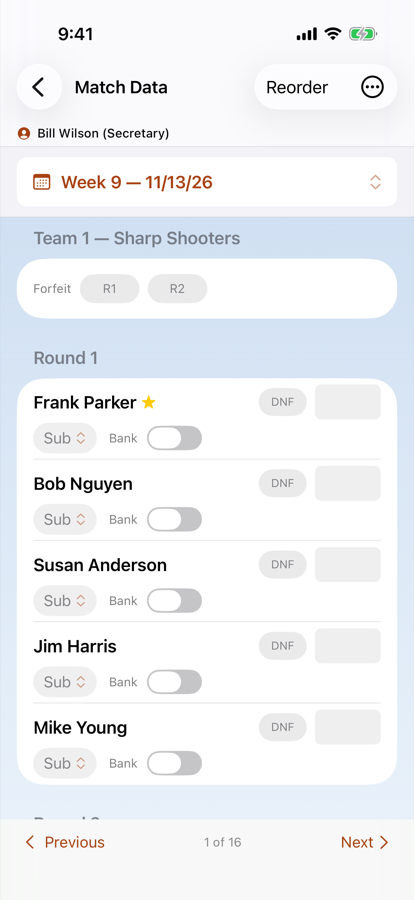</p>

The secretary can enter or edit scores directly without going through the captain submission flow.
From the league screen, tap **Scoring**. The screen it opens is called **Match Data**.

> **Enter a night's scores on one device.** If you have Pull! on more than one secretary device — your
> iPhone and an iPad, or a backup secretary's phone — type and approve that night's scores on one of
> them and let it finish before touching scores anywhere else. Two devices changing scores at the
> same time cannot both keep their changes: see *Using more than one secretary device* in Section 14.

**It opens where the typing stopped.** The screen lands on the earliest week that still has a team
with no scores, and on that team — not on the next empty week — so a night entered for some teams
and not others keeps you in it. Any single score counts a team as started, because a shooter who did
not turn up is recorded by having no score at all; a team would otherwise read as unfinished for the
rest of the season. A team with a forfeit marked that week counts too. **A team that did not shoot
and has nothing marked keeps the screen on that week**, so forfeit its rounds if that is what
happened. Use the week selector to go anywhere else.

On a phone the screen is laid out **a section per round** — every shooter's round 1, then every
shooter's round 2 — because that is the order a paper scoresheet reads in. **On an iPad the rounds sit
side by side**, under **Round 1** and **Round 2** headings, one line per shooter; if the screen is too
narrow for them (Split View, or a very large text size) it goes back to a section per round. Either
way, **Next** on the number pad walks down round 1 before starting round 2. For each shooter you can
type the round scores, switch in a substitute, or toggle **Bank**; the substitute picker and the bank
switch appear under the name once, since both belong to the shooter's whole night rather than to one
round.

**Scores are typed on the app's own number pad**, not the system keyboard. Tap a score box to select
it, then type; **Back** and **Next** sit beside the digits, so moving down a round's column of
shooters never means looking away from the keys. The first digit you type replaces what is there, so
correcting a score is retype rather than delete-then-type, and a number too large for the round
starts again rather than being trimmed to something nobody shot.

**A straight shows.** A box holding a perfect round turns gold with a star, and the phone gives a
small tap as it goes in — here, on a team's own score screen, and on the captain's scorekeeper sheet.
Once every team has scores for the week, a green **Every team has scores** row appears at the top of
Match Data. Teams on a bye do not need any.

**To match the order on the paper, tap Reorder.** Round 1's rows grow drag handles; move a shooter and
every round follows, because a squad shoots one order for the whole night. Tap **Done** to go back to
typing. The two modes are separate because a list cannot offer drag handles and live score boxes at
the same time, and entering Reorder clears the selected box — the positions have moved, so the
cursor would otherwise be pointing at a different shooter than the one you left it on.

**Reorder changes only what you see.** It is there so the screen matches the paper on a night when
subs have the squad standing in a different order; the team's shooting order is not changed, and
the next week (or the next time you open Match Data) starts from the roster again. To change the
team's order for good, use **Edit** on the team.

Every change is saved on this device immediately — there is no submit button and nothing is lost if
you close the screen. Typed scores reach your other devices once you pause typing for a few seconds,
or straight away when you change team or week or leave the screen; bank, DNF and substitute changes
go at once.

Direct entry bypasses the pending-sheet approval queue entirely. If you are running the league from
paper, this is the screen you will spend the season in.

A team's week can also be edited from **Team Detail**, which shows one team at a time — useful when
you are correcting a single team rather than entering a whole night.

### Starting average for a new member

When **Use Starting Average** is on, a member can be given an average to stand in for history they do
not have yet, so they have a handicap on their first night. Set it when creating them, or afterwards
from the member's **Edit** sheet → **Starting Average**.

Two things worth knowing. Fractions are kept — 21.5 is spread across the week's rounds rather than
rounded down. And the starting average does not stop counting the moment a real score arrives: it
sits in the averaging window alongside their own rounds and is the first thing dropped once they have
shot enough of their own.

### Totals-only mode

If you want to skip per-shot tracking and record only each shooter's round total, enable **Totals
Only** during pre-round setup. The shot grid is replaced by one box per round for each shooter,
typed on the app's own number pad. Once submitted and
approved, the totals are posted just like per-shot data; however, per-station statistics will not be
available for those rounds.

---

## 9. Corrections and Fixing Mistakes

### What happens to past weeks

**A week's roster is frozen the first time a score is entered for it.** Everything after that —
someone quitting, a new shooter joining, a team being reorganised — applies to weeks not yet scored
and leaves the played ones exactly as they were.

This is what makes a printed report stay true. Without it, removing a shooter in week 6 would quietly
re-score weeks 1 through 5 without them, and every standings sheet you had already handed out would
stop matching the app.

Two consequences:

- Weeks you have **not** yet scored still follow the live roster, so fixing a roster before the
  night's scores go in works exactly as you would expect.
- Each week freezes independently, at the moment it is first scored. Entering week 5 before week 4
  freezes week 5 only.

### Fixing a score

Open **Scoring** (the Match Data screen), pick the week, and retype the round. The change saves immediately
and every report recalculates.

### A substitute was recorded as the rostered member

This is the common one: the scores went in under the rostered member's name, but a substitute
actually shot.

Open the week in **Scoring**, find the slot, and select the substitute in the
**Sub** picker. The rostered member's score for that week is removed and the boxes empty — the
numbers already typed do not move across. Retype the rounds and they are credited to the substitute;
the team total, the standings and both shooters' averages all follow.

Note the reverse: switching the substitute back off leaves the slot empty, because the rostered
member's score was removed when you made the correction. Retype it.

### A week was approved too early

Approving a sheet posts its scores. To give the scorekeeper their sheet back, use **Return to
Scorekeeper** — retyping the week yourself or clearing it would not.

An approved sheet is no longer under **Approvals → Score Sheets** — that list holds only sheets waiting for
you. Reach it through the scores instead: **Scoring** → that week → page to the
team → **Shot-by-Shot Detail**, then scroll down and tap **Return to Scorekeeper**. The screen that
opens is titled **Reject Sheet**; add a note and tap **Reject** — that is the return. Three things
happen together:

- That team's scores for the week are **removed**, and any bank reservations they consumed are
  released. The scores go because a week showing numbers whose sheet is back in somebody else's
  hands is a disagreement nothing on screen explains — and a resubmission would overwrite them
  silently anyway.
- The sheet reopens for the scorekeeper **with their grid exactly as they left it**, so a correction
  is an edit rather than a re-entry.
- They are asked to keep score again, and their banner comes back.

Only that team is affected — including any substitutes who shot for it — and the week's frozen
roster is kept, so re-scoring it still scores against the line-up that actually shot that night.

### A bank was used by mistake

Switch the **Bank** toggle off for that shooter. The banked entry is removed and the earlier score it
consumed is released, so it can be banked again for a different week.

### A whole week needs redoing

Open **Scoring**, tap **⋯ → Clear Scores**, then **Clear Week**, then pick the week.
Only weeks with something to clear are listed, and a cancelled week is not — uncancel it first if
you need to clear its scores.
That week goes back to un-played: every shooter's scores for it, its substitute records, any
forfeited rounds, **and its score sheets**. Every other week is untouched, and so is the roster the
week was scored against — so re-entering it scores against the line-up that actually shot that
night, not today's.

The score sheets going is what lets the week be scored again by the people who scored it. A
submitted or approved sheet — or scores the secretary entered by hand — is what closes a captain's
*"You're scorekeeping"* banner, and the
banner is the only door into the sheet — so a week cleared with its sheets left behind could only
ever be re-entered by the secretary, by hand.

A week whose sheet was **submitted but never approved** can be cleared too, even though it shows no
scores: the submission is work to clear, and it has already closed the captain's banner. A captain's
unfinished **draft** does not count — it blocks nothing and it is theirs.

The same row also offers **Clear All Scores**, which wipes the *entire* season's scoring. That is
the drastic one, and it is also what unlocks everything listed under
[What locks when scores exist](#what-locks-when-scores-exist).

For a handful of wrong numbers, neither is needed — just retype them.

### A member left after the season started

Remove them from the team (**Edit → Remove Member**; see
[Removing someone mid-season](#removing-someone-mid-season)). Their slot goes vacant, they move to the substitutes pool, their scores
stay on their own record, and every week already scored is untouched.

If someone new takes their place, add the newcomer to the team. They start with no history: their
handicap builds from their own rounds, and they inherit nothing from the person whose slot they took.

---

## 10. Roster Changes

### Secretary — direct edits

As the secretary, tap **Rosters** and page to the team. **Add Member** is shown while a slot is open.
Tap **Edit** to rename the team, change its display number, reorder shooters (the captain stays
first), **Remove Member**, or **Delete Team** (only before any scores exist). To change the captain,
open a member, tap **Edit** and turn on **Captain**. All changes take effect immediately.

### Captain — submitting changes for approval

Captains can enter Edit mode on their own team. The roster order is the secretary's to change; a
captain matches the night's shooting order on the scoresheet instead. To edit a member's fields (name, email, phone, club member, classification,
sex), tap the
member's name and tap **Edit**. Changes are staged; when you tap **Submit**, a pending change request
is sent to the secretary.

The captain sees a **Pending approval** banner inside the member's edit screen until the secretary
acts. Re-submitting a change replaces the previous pending request.

### Secretary — approving or rejecting roster changes

A count appears on the **Approvals** button on the league screen, and beside **Roster Changes** inside
it. Tap it to see the inbox. Each entry shows the current value vs. the proposed value for
every changed field. Tap **Approve** to write the changes to the member record, or **Reject** with an
optional note to send it back.

---

## 11. Schedule Management

Everything in this section is secretary-only. The actions live in the **"…"** menu at the top right
of the schedule view, and what it offers depends on the week on screen:

- **Assign Scorekeepers** — it reads **Assign Remaining Scorekeepers** when some are already
  assigned, and **Edit Scorekeepers** once every team has one. Not on a cancelled week or one with scores.
- **Remove Scorers** — whenever the week has assignments, including scored and cancelled weeks.
- **Cancel Week** — or **Uncancel Week** on a cancelled week. Not available while the week on screen
  has scores.
- **Regenerate Schedule**, **Import Schedule** (League Ranking only) and **Clear Schedule** — until
  the first score is recorded.

A captain or view-only collaborator opens the same screen with no menu at all.

**Cancel Week** opens one sheet where you pick the week and then the action — **Move to End of
Schedule** or **Skip Week (No Matches)**. Only weeks that are neither already cancelled nor already
played can be selected.

### Cancelling a week

Open the **"…"** menu, tap **Cancel Week**, choose the week, and choose **Skip Week (No Matches)**.
The week's date and week number are preserved; the match is simply flagged as cancelled and skipped
in all scoring and report calculations.

### Putting a cancelled week back

Page to the cancelled week, open the **"…"** menu, and tap **Uncancel Week**. The week returns to the
schedule exactly as it was — same date, same week number, same matchups.

If the week already had scores when it was cancelled, they were never deleted, only ignored; putting
the week back makes them count again. So a week cancelled by mistake is fully recoverable.

### Moving a week to the end

If a match night needs to be rescheduled, open the **"…"** menu, tap **Cancel Week**, choose the
week, and choose **Move to End of Schedule**. The match is placed one week after the current last
match. Its week number label does not change — only its date does. This is intentional, and it is
why reports always sort by date rather than week number.

### Regenerating the schedule

Open the **"…"** menu and tap **Regenerate Schedule**. The sheet opens on the existing start date and
bye setting, and reads the teams you have created and the current weeks, flights, sites and match
type settings — so changing any of those and regenerating rebuilds the season around them. Tapping **Replace** discards
every week of the current schedule.

**Regenerate is unavailable once any score has been recorded.** Scores are stored against a week
number, so a new schedule would leave each one attached to a different week's matchups and byes. If
you genuinely need to start the season over, use **Scoring → ⋯ → Clear Scores** first;
then Regenerate becomes available again.

### Moving the season start date

**Settings & More → League Settings → Schedule → Season Start → First Match** (shown once a schedule exists).
Changing it moves every week by the same amount,
keeping the gaps between them and their week numbers — so a week you had already pushed to the end
stays at the end.

It is available only while the season has **no scores at all**. Once anyone has shot, the dates are
fixed: moving a week that has already been played makes no sense, and moving only the remaining weeks
could put one before a week that has been shot, which would scramble every report. To move a single
week mid-season, use **Cancel Week → Move to End of Schedule** instead.

### Clearing the schedule

**Clear Schedule** removes every week, matchup and bye, leaving the league ready to generate or
import a new season. Teams, members and settings are untouched.

It is the way back to an empty schedule, which **Generate** needs — Generate only appears while there
is no schedule, and Regenerate replaces one season with another rather than clearing.

Like Regenerate, it is **unavailable once any score has been recorded**, for the same reason: scores
are stored against a week number, and removing the weeks would leave each score attached to nothing.
Use **Clear Scores** first if you genuinely need to start over.

### Changing the match type

**Team vs Team** and **League Ranking** weeks are built differently — a head-to-head week pairs teams
with each other, a ranking week simply places every team on a site and flight — so a schedule
generated for one mode is meaningless in the other.

Because of that, changing **Match Type** in **Settings → General** while a schedule exists asks you
to confirm, and then takes you straight to the regenerate sheet. If you close that sheet without
generating, the match type reverts: the setting and the schedule always agree.

Once scores exist, Match Type is locked and shown as plain text instead of a picker, for the same
reason Regenerate is barred.

---

## 12. Reports and Export

Tap **Standings & Reports** from the league screen to see the full report suite. All reports are available as an
on-screen view and as a shareable PDF. Pick the week at the top; the choice carries between report
tabs.

**A shooter's name opens their screen.** Tap a name in Results, Roster, Leaders, Awards
or a tournament's placings, on a score sheet under review, on a substitute's screen or in the
scorekeeper list, to see that shooter's scores, average trend and details; a substitute opens their
own screen. Names on the score-entry screens and in pickers don't open anything, since tapping
them there already picks, ticks or marks someone.

**A team's name opens its roster.** Tap a team in the Standings, a team's heading on
Results or Roster, anywhere on the Schedule tab (the site grid, a matchup or the bye line), or on
the Schedule screen, to open that team's screen; **Previous** and **Next** page on through the
other teams from there. Lists work the same way: a name on a team's roster, Substitutes,
Find a Member, Entrants, Participation or a team's row on Finances opens it.

Above the standings, four tiles give the league's season so far, through the week selected:
**Rounds Shot**, the **League Average**, **Straights**, and **Shooters**. They follow the averages'
rules, so banks, cancelled weeks and unfinished rounds are left out.

<p>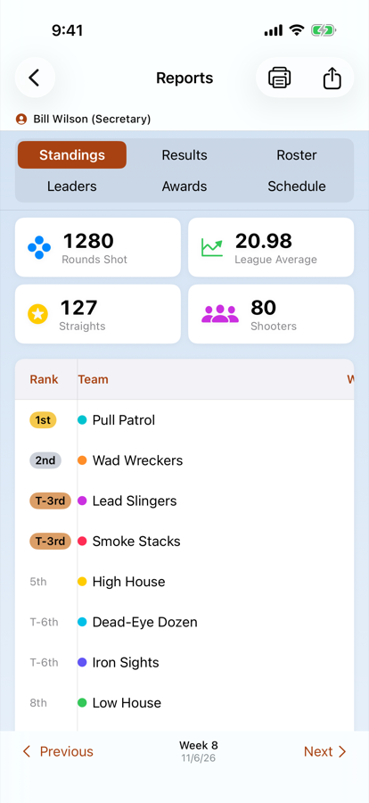 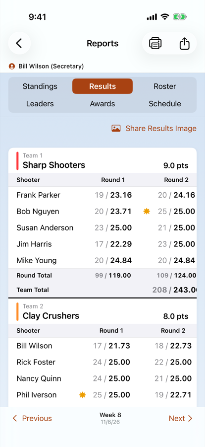</p>

**Standings** — season point totals and rankings for every team, plus what the selected week paid and
the team's handicap-adjusted score for it. A team that did not play shows **BYE**. Both scoring modes
use the same table; only the source of the points differs.

Rank is its own column and is written as a place — **1st**, **2nd**, **3rd**. Teams level on season
points share the higher place and are marked **T-**, so two teams tied for second both read
**T-2nd** and the next team is **4th**.

On a phone the table **scrolls sideways** and the rank column stays put, so a row is still
identifiable once the team name has scrolled away. Nothing is left out: the week's points, the
season total and the weekly score are all there, a swipe to the left.

**Results** — the selected week in detail. In Team vs Team mode, one block per pairing with the
match points each round was worth. In League Ranking mode, one block per team with its rank points.
Scores that did not count toward the team total — those below the Valid Scores cutoff — are shown in
red with a strikethrough, so you can see at a glance which were dropped. A shooter whose scores were
dropped in every round also has their name struck through.

Each team's block ends with its **round totals** and then the **match total**, in the same columns
as the shooters above them, so a total reads straight down the column it totals. Both are given as
**raw / handicap** — the scores as shot, then the handicap-adjusted figures the match was decided
on. The raw figure is the raw scores of *the shooters whose adjusted scores counted*, which once
handicaps differ is not the same as the highest raw scores on the team. In Team vs Team mode the
points take the raw column instead, since a match is settled on the adjusted figures and the points
beside them are what the row is there to show.

On a phone this card scrolls sideways as one piece, names and all.

**Share Results Image**, at the top of the Results tab, makes a picture of the week for your club's
group text: who won each match (or each team's place and points), everyone who shot a straight, the
night's high gun, and the top three in the standings. A tournament's picture shows the top five for
the event instead. It is drawn the same way whoever shares it, at a standard text size in light
mode, so it reads the same on everyone's phone.

**Roster / Member Stats** — per-member averages, handicaps, rounds shot, bank usage, and improvement
scores. The PDF ends each week with a **Targets** summary: clays thrown, clays broken and accuracy
for that week and for the season to date, plus how many bank scores the league has used. Turn on
**Show Roster Categories** in Settings to split those figures into club members and guests. The same
numbers appear on screen at the foot of the **Results** tab. Every rostered member is always listed,
so you can print team sheets as soon as the rosters are entered; a member with nothing shot yet
shows a dash rather than a zero. Before the season every substitute is listed too; after that, only
the substitutes who have shot.

<p>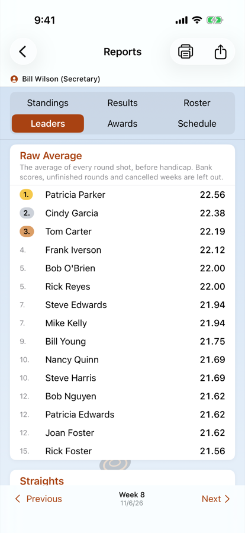 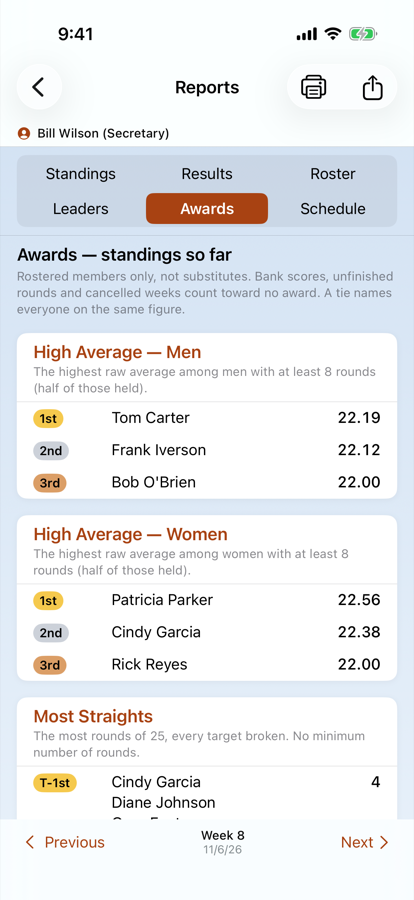</p>

**Leaders** — the top 15 in each category, among rostered members unless **Substitutes in
Leaders** is on under **Banks & Substitutes**. Each list says what it ranks under its title:
- **Raw Average** — the average of every round shot, before handicap.
- **Straights** — rounds of 25, every target broken. **24s Shot** and **23s Shot** count rounds one
  and two targets short.
- **Most Improved** — the rise from a shooter's first rounds (Improvement Rounds) to their season
  average.
- **Consistency** — the steadiest shooters: the spread of their round scores once their best and worst
  rounds are dropped, lowest first. Its leader is the **Most Consistent** award's winner.

Most Improved and Consistency are seasons only, use the Awards' rules on how many rounds a shooter
needs, and list rostered members only.

**Awards** — the season's awards: High Average for men and for women, Most Straights, Most
Consistent, Most Improved, Biggest Slump, and the top three teams. Each award prints the exact rule
under its title, with this season's round counts filled in, for example *"The highest raw average
among men with at least 9 rounds (half of those held)."* Substitutes, bank scores, unfinished
rounds and cancelled weeks count toward none of them. Each award lists its top three places, 1st,
2nd and 3rd, with gold, silver and bronze medals on screen. A tie shares a place and names everyone
on the same figure (two tied for 1st are both *T-1st*, and the next is 3rd). The
secretary sees the tab all season, headed *standings so far*; everyone sees it from the last night.
With **One Award per Shooter** on (Settings → Fees & Display), nobody wins twice. Each award still
lists the shooter who leads it if they already won an earlier award, with no medal and the award they
took (*Won High Average — Men*); then the top three of those still eligible, where 1st wins and 2nd is
next in line. The PDF prints the places and *(won …)* in words.

**Schedule** — the full season with dates, sites and flights, and the scorekeeper grid.

**Participation**, on the **Rosters** screen, shows who shot.
**Week** lists everyone who shot the selected week, with their scores. **Season** is a grid with
members down the side and weeks across, one square per night: green for shot, orange **B** for a
bank, purple **S** where a sub covered them, and red **–** for absent. A square is left blank for a
week the member was not on the team. Type in the **Name** box at the top to show only the members
you want — a first name, a last name, or the start of either — in both views. Tap a name to open
that member's screen.

### Printing

Tap the **printer** at the top of Reports, beside the share button, to print the report on screen
for the week on screen: one week of Standings, Results or Roster, the way you would hand it out
tonight, rather than the whole season an export carries. Leaders and Awards print through the week
on screen, and Schedule prints the whole schedule.

On the **Roster** tab the printer asks which: **Print Roster**, or **Print All Members** for the
all-members grid, which has no tab of its own. It prints landscape.

Before the first night only the Roster and Schedule have anything to print. The pages are the
same ones an export makes, so what prints is exactly what you would have exported.

### Blank score sheets

Tap the **printer** at the top of the **Schedule** (a tournament's **Events**) to print a paper score
sheet for every team shooting the week on screen, each team on its own landscape page. Anyone in the
league can print them.

- **At the top:** the league name, the team or squad, and the week or event, its date, the site or field, the
  flight and the start time. A tournament event also shows its target format.
- **One table per round,** with a box for every target. A skeet sheet marks each box **H** or **L**,
  and doubles keep each pair's boxes together.
- **The shooters** in shooting order, with any substitute already recorded for the week in the slot
  they fill and two blank rows for a walk-in. A handicap event prints each shooter's yardage.
- **Raw, HDCP and Total columns,** with HDCP filled in from the nights before. A tournament has no
  handicap, so its sheet has no HDCP column.

Rounds that don't fit on one page continue on the next.

### Exporting

Tap the **share button** at the top of Reports to open **Export Reports**: a list of every report
the app can export, each with a switch and the name its file will be given. Turn off what you do not
need this time — the **Schedule** rarely changes once it is posted — and tap **Export** to share the
rest together.

The list holds **Standings**, **Results**, **Roster**, **All Members**, **Leaders**, **Awards** and
**Schedule**. Awards starts switched off, and appears only where the Awards tab does. One report has
no tab of its own:

> **All Members** — every member of the league on one line, with each round of every week across the
> page and each round's season average at the end. Substitutes are listed alongside rostered members,
> in surname order, because this is the sheet you read down to find a person rather than a team. A
> week still to be shot is blank, a cancelled week gets no column at all, and a **B** beside a figure
> (in red) means a bank score — an earlier week replayed, not shot that night. It is **landscape**
> and it is wider than a phone, which is why it is a sheet you export and print rather than one you
> scroll: a season with more weeks than fit the page continues on the next page.

> **An export is the whole season, whichever week you are looking at.** **Standings**, **Results**
> and **Roster** each contain *every* week that has scores — one week per page, **newest week
> first**, so each PDF opens on the week just played and the history runs backwards behind it.
> **All Members**, **Leaders** and **Awards** are each a single table through the latest of those
> weeks, and **Schedule** is the whole season as always. Before the first night, when there is
> nothing to archive, the list offers only the **Roster** and the **Schedule** — the two sheets worth
> having on paper at that point.

**Naming the files.** Under each report is the name its file will have. Leave it blank for the dated
name shown in grey, or type your own — `standings`, say, if your club's website expects that name
every week. `.pdf` is added for you. Two reports cannot share a name.

**The secretary's choices are kept.** On the secretary's and backup secretaries' devices — in
Secretary or Captain mode — the switches and names you set are saved with the league and reach the
other secretary devices, so they are set once for the season. **Restore Defaults** at the bottom of
the list puts them all back. A captain can change them for one export, and nothing they change is
kept.

### What the files are called

Every exported report is named for the league, the report and **the week it covers**:

```
Fall_League_2026_Standings_Through_Week_3.pdf
```

The week is the one printed inside, counted the way the app displays it, so a file cannot disagree
with its own contents. An export uses the latest week it covers, and the **Schedule** carries
the suffix too even though it is a whole-season sheet — the files of one export are filed and
sent on as a set, and one of them not sorting with the others is the confusion this avoids.

**Once the season's last night has been shot**, the reports covering it say so: the files end in
`_Final` (`Fall_League_2026_Standings_Final.pdf`) and the sheets are titled **Final Standings**,
**Final Rosters** and so on, even when the last night was a week moved to the end of the schedule.
A results sheet keeps its week, since it covers one night.

Spaces in the league name become underscores and any other awkward characters are dropped, so the
files are safe to put in a
shared folder or attach to an email without being renamed on the way.

### Exporting and importing data

On the league screen, tap **Settings & More → Export League**, then **JSON — for a Backup** or
**CSV — for a Spreadsheet**; the window says what each is for. The share sheet opens straight away,
for AirDrop, **Save to Files**, Mail and the rest.
Both carry the whole league — rules, schedule, teams, rosters, members and every score. Only the JSON
carries the requests as well: captains' score sheets and member edits. Use JSON
for a backup, and CSV when you want to open the season in a spreadsheet.

**Copy and Export League are the secretary's.** They appear only in Secretary mode — the owner and backup
secretaries — because an export is the whole league, every member's email, phone and fee status
included, and a copy is a working league owned by whoever made it. Everyone on the share can still
save and send the PDF reports, which carry names and scores only. This is not a lock on the data:
everyone on the share holds the league on their device, which is how the app works at all. It just
stops the contact list being one tap from a file anyone can forward.

**An imported league is a new league, not the old one returned.** Restoring from an export —
after deleting the league, say — gives you a league that nobody else has yet:

- **It is private and unshared.** The old league's iCloud share does not carry over, so share the
  imported league again and have everyone accept the new invitation.
- **Every member comes back unlinked.** Neither export format carries the links between members and
  their devices — the file may have travelled anywhere, and a link should not be re-made from a copy
  of one. Each captain picks their name again under **My Identity** once they have accepted, and you
  scan their device on **Linked Devices** — and link yourself under **You**.

The export sheet lets you share the file via AirDrop, Mail,
Files, or any other destination. Taking a JSON export before a risky change — or at the end of a
season — is the simplest backup there is.

To import a previously exported file, tap the gear icon on the main Leagues screen, choose **Import
League** (on an empty list, **Import a League**), and pick a JSON or CSV export. The importer also accepts JSON files from the older Java-based scoring app —
members, teams, rosters, schedule, and scoring history are carried over.

**Read the result message.** It reports how many leagues actually landed, and names anything it
skipped:

- *"a league of that name is already here"* — rename it in the file, or rename the one on the device.
- *"already on this device under a different name"* — the file is a copy of a league you already
  have, and the two are the same league as far as the app is concerned. Delete the copy on the device
  first, or import into a fresh install.

A JSON export carries no credentials of any kind — there are none in the app to carry. It restores
every member, team, score and week.

---

## 13. League Fees

Everything in this section is secretary-only. The **Finances & Member Breakdown** row does not appear at all for
captains or view-only participants.

### Setting the rates

Two rates live in **Settings & More → League Settings → Fees & Display**: **Member Fee** for club members and
**Guest Fee** for everyone else. Each member's **Club Member** toggle, on their Status section,
decides which of the two rates applies to them.

### Recording a payment

Open the member from their team roster and turn on **Fee Paid** in the **Status** section. Only the
secretary can set it — a captain sees the toggle disabled, and unlike the other member fields it is
not something a captain can submit for approval. Collecting the money is the secretary's record.

A new season made with **Start Next Season** starts with everyone **unpaid**, so you are collecting
from a clean slate. A **Copy** preserves who had paid, because it is the same season.

### The Finance screen

From the league screen, tap **Settings & More → Finances & Member Breakdown**, which opens on **Finances** (the
**Member Breakdown** tab counts who shoots in the league). At the top, a ring shows how much of the
league's fees has been collected so far. Each team then shows:

- how its roster splits between club members and guests,
- **collected / billed** — how much of that team's season fees have come in, with a bar that fills
  as the team pays,
- and what is still **due**, or *Paid in full* once it all has.

Underneath, **League Totals** sums Billed, Collected and Due across every team, and **Shooters**
counts the people: everyone rostered (club members and guests) and the substitutes.

**Tap a team to mark who has paid.** Each member has a **Paid** switch, with their rate beside
their name; **Mark All Paid** and **Mark All Unpaid** do the whole team at once, and **Roster** opens
the team. **Fee Paid** on a member's own screen is the same switch.

**The fee belongs to the roster slot, for the season — not to whoever shoots on the night.** That
single idea explains the rest of this section.

- **Substitutes are never billed.** A sub is standing in for a rostered member whose seat has already
  been paid for, so billing them would charge the club twice for one place on the team. They appear
  in no Finance row, and there is no way to bill one from inside the app — deliberately.
- **Billing follows the current roster.** A member who moves off a team stops counting toward that
  team's billed total.
- **Changing a rate re-prices the whole season immediately**, including teams that have already
  paid. Set the rates before the season starts.

#### One case the screen gets wrong

If a **paid** member leaves a team mid-season and somebody takes their slot, the seat is billed
again and the payment already made against it disappears from the team's Collected figure. The
screen will show money outstanding on a seat the club has in fact been paid for, and their own
member record still reads **Fee Paid**.

Until that is settled, check the departing member's record before chasing the replacement for money.
It is logged as a known issue rather than fixed, because what *should* happen — carry the payment to
the seat, refund it, or bill the newcomer in full — is a club decision rather than an app one.

---

## 14. Sharing a League Across Devices

The app uses iCloud to share leagues between devices. All participants must be signed into iCloud.

### Who owns a shared league

The league lives in the iCloud account of whoever created it. That person is the secretary — it is
not a setting, and it is not tied to a name on the roster. Everyone else holds a copy shared from
that account.

Two consequences worth knowing before you start:

- **Only the owner can invite people or stop sharing.** A backup secretary can edit everything else,
  but cannot re-share the league or delete it.
- **The league cannot currently be moved to a different iCloud account.** If your club's secretary
  changes, there is no in-app handover. The practical options are to add the incoming secretary as a
  **backup secretary**, which gives them every editing power while the data continues to live in the
  outgoing secretary's account, or to start a fresh league under the new secretary's account for the
  new season.

So if the app is being set up for a club rather than for yourself, create the league on the account
that will still be running the league next season.

### Access, link and role: three separate things

A captain needs all three. Each is set in a different place, which is why somebody can be "shared" and
still be unable to do anything.

| | The question it answers | What it belongs to | Where it is set |
|---|---|---|---|
| **Access** | Can they see the league, and may they send anything? | An Apple ID, so every device signed in to it | **Settings & More → Share League** (Apple's screen) |
| **Device link** | Which member is this phone? | One device | **Settings & More → Linked Devices**, by your scan |
| **Role** | What does that member get to do? | A member of the league | The team's captain, and **Settings & More → League Settings → Backup Secretaries** |

What that means in practice:

- **Can Edit with no device link:** they read everything, and the top of the screen says **Identity Not
  Set**. They cannot submit anything yet. This is where every captain starts.
- **A device link with View Only access:** the device acts as nobody, and the link waits. When that
  person has Can Edit again, the name comes back with no new scan.
- **One Apple ID on two devices:** they accept once, and the league reaches both devices with the same
  access. Each device still needs its own scan. A phone you never scanned stays **Identity Not Set**.

**Anyone who only reads the league** needs access only: a View Only invitation. They never pick a name
and never need a scan.

**Captains and backup secretaries** need all three, so they must be in the league as a member before
you link them. There is nothing to hand out: they accept the invitation, pick their own name under
**My Identity** on the league screen, and you scan the code their device shows.

### Linked Devices — linking captains in person

The **Linked Devices** row appears under **Sharing** on the **Settings & More** screen for the league's owner, while acting as
Secretary. It is where you link each captain's and backup secretary's device to their name, and
unlink it later.

**Link with the person in front of you.** At the kickoff meeting or on the first night:

1. The captain opens the league on their device, taps **My Identity** on the league screen and taps their name.
   Their device shows a code.
2. You tap **Linked Devices** → **Link a Device** and point your camera at the code.
3. Pull! asks **Link This Device to Dave Ellis?** Tap **Link**.

Their device takes the name the next time it syncs. Linking needs your device's camera; on a device
that cannot scan, the button is unavailable and says so.

**Only link a device you can see in the hands of the person it is for.** The code holds nothing
secret: what makes the link trustworthy is that you saw who held it. A code expires after 10 minutes,
so an old screenshot will not scan, but a photo sent to you a minute ago would. If a captain cannot
come, link them when they can.

The confirm message tells you if the device is linked to somebody else now (it moves to the name you
are linking) and how many devices the member already has, so you can tell a second phone from a
replacement.

**Identify yourself too.** Your own devices need no scan. The screen offers a **You** section at the
top, suggesting whichever member this device is acting as. Tap it, or **Someone else…** to choose.
Your **own** other devices can pick your name either way — every device that owns the league is you.

Once linked:

- their device takes that name by itself, the next time it syncs;
- **no other device can take that member**, and no captain's device can take *any* name you have not
  linked to it, which is what stops somebody taking a captain's powers by tapping a name;
- the **Linked** list on the same screen shows each member's devices, with **Unlink** for each.
  **Unlinking stops that device acting as the member** — on its next sync it drops the identity and
  shows an alert saying so. Unlinking does not remove their access to the league; that is
  **Settings & More → Share League → their row → Remove Participant** (**Remove Access** on some versions of iOS).
- **Removing one person from the share does not unlink them,** as long as others remain. The link is kept
  in the league, so unlink them here too if they have left. **Removing the last person ends the share,**
  which clears the links as **Stop Sharing** does.
- **Stop Sharing does clear the links**, all but your own. See
  [What each action removes](#what-each-action-removes).

If a member changes their Apple ID, or signs out of iCloud, their device stops acting as them rather
than continuing under the previous account.

**Choosing "Not Set" does not unlink you.** The link is the secretary's record: your device stops
acting as that member, but it stays linked to you, so nobody else can take your name and you can pick
it again without a new scan. If you want the link itself removed — you have changed phones, or you
are leaving the league — ask the secretary to Unlink you.

**More than one device.** A member can be linked to several devices — a captain's phone and iPad,
say. Scan each one; the others keep their links. Each device has its own row and its own **Unlink**,
labelled *Linked device 1*, *Linked device 2* — or just *Linked device* when there is one — and
**This device** for the one you are holding. **A replaced phone, or Pull! deleted and reinstalled, is
a new device**: scan it, then unlink the old one, which no device holds any more.

### Sharing as the secretary

**Share League is owner-only.** It appears under **Sharing** on the **Settings & More** screen only while you are acting as owner.
If you have switched to Captain mode with the role picker, switch back first or you will not see it.

Everybody joins the same way, by a personal invitation to their Apple ID's email or phone. What you
choose for them decides what they can do:

| | Captains and backup secretaries | Anyone else who wants the league in the app |
|---|---|---|
| Access | **Can Edit** | **View Only** (iOS 27 calls it **Can View and Download**) |
| What they can do | Pick their name under My Identity, be linked by your scan, and submit score sheets and roster changes | Read the schedule, substitutes, teams, rosters, scores and reports |
| See email, phone and fees | Their own team's (a backup secretary, everyone's) | No |
| How you remove them | Their row under Participants | The same |

For a whole club, sending reports is usually easier than inviting everybody: see
[Exporting](#exporting).

#### Do it in this order

1. **Put them in the league.** Make the person a captain on their team, or a backup secretary, first.
2. **Invite them.** Tap **Settings & More → Share League**. Apple's sharing screen opens.
   1. Tap **Add Participant** (iOS 27) or **Share with More People** (iOS 26), and enter their Apple ID
      email or phone number.
   2. Before sending, make sure they will get **Can Edit**. iOS keeps this under **Share Options**, or
      **Sharing Options** on some versions.
   3. Send the invitation by Messages or Mail.
3. **Wait for them to accept.** They appear under **Participants** once they have.
4. **Link their device.** See [Linked Devices](#linked-devices--linking-captains-in-person).

**Leave Who Can Access on People You Choose.** If you change **New Participants Can** and iOS asks how to
apply it, choose **New Participants Only**. **Change for All Participants** would change every captain's
access too.

**Apple draws this screen, not Pull!,** so its wording changes with the iOS version of the device you are
holding. The same league can read differently on your iPad and your iPhone.

**Leave the Co-owner slider alone.** iOS 27 can show it on a participant's row. Pull! has not been tested
with a co-owner, and a backup secretary is the way to share the running of a league.

#### What a captain does

1. Installs Pull!, then opens the invitation on the iPhone or iPad signed into the Apple ID it was
   sent to, and accepts it.
2. Waits for the league to appear in their Leagues list, usually 10–30 seconds.
3. Opens the league, taps **My Identity** on the league screen, and taps their own name. Only captains and backup
   secretaries are listed, so put them on a team as captain before inviting them.
4. Shows you the code on their device, and you scan it on **Linked Devices**. Until you do, their
   device acts as nobody in the league.

#### What each action removes

| What you do | Who loses the league | Captains' device links |
|---|---|---|
| **Linked Devices → Unlink** | Nobody | That one device's link |
| **Share League → their row → Remove Participant** or **Remove Access** | That Apple ID | **Kept** while others remain, so unlink them too. **Removing the last person ends the share,** and the links go as they do for Stop Sharing |
| **Share League → Stop Sharing** | **Everyone but you**, captains included | **Cleared** |

Your own league and scores stay on your devices in every case, and these are not affected: **your own
device links**, the **Backup Secretaries** list, and open scorekeeper assignments.

**After Stop Sharing, a returning captain starts again:** a new invitation, then pick their name, then
your scan. The clearing runs on the device you tapped it on, and it can miss, so glance at **Linked
Devices** afterwards. Any link still listed can be removed with **Unlink**:

- **iCloud could not be reached.** Pull! fetches the latest league before clearing, because the links
  travel with the scores and an out-of-date device could overwrite newer scores. If the fetch fails, it
  leaves the links.
- **Another secretary device had unsent member changes.** When it sends them, it can bring cleared links
  back. Let your other devices sync first.
- **Your device had no link of its own** and was acting as another captain. That captain's link stays.

**A person you removed one at a time keeps their link.** Pull! cannot tell which device belongs to which
participant. If you invite them back, their device takes the name again with no scan, so **Unlink** them
when they should not have it.

#### Changing someone's access later

Re-open **Settings & More → Share League**. Each invited person has a row under **Participants** showing their
name and access. Tap a row to change their access or to remove them. That list is also the quickest way
to confirm an invitation landed. Check it before assuming something is wrong with the app.

### What each role can do

Share permission decides whether a device can write at all. What it may write is then decided by the
identity linked to the device and by your Backup Secretaries list — "Can Edit" on its own does not
make somebody a secretary.

| Capability | Secretary (Owner) | Can Edit | View only |
|---|---|---|---|
| View scores and reports | ✓ | ✓ | ✓ |
| Hold a linked name / view scorekeeper banner | ✓ | ✓ | — |
| See members' email, phone and fees | ✓ | ✓ (if backup secretary; a captain for their own team) | — |
| Submit scorekeeper sheet | ✓ | ✓ (if captain) | — |
| Submit roster change for approval | ✓ | ✓ (if captain) | — |
| Edit member fields (direct) | ✓ | ✓ (if backup secretary) | — |
| Approve / reject sheets and edits | ✓ | ✓ (if backup secretary) | — |
| Generate or import the schedule | ✓ | ✓ (if backup secretary) | — |
| Cancel or move a week, assign scorekeepers | ✓ | ✓ (if backup secretary) | — |
| Change league settings | ✓ | ✓ (if backup secretary) | — |
| Add / remove teams or members | ✓ | ✓ (if backup secretary) | — |
| Copy or export the league | ✓ | ✓ (if backup secretary) | — |
| Delete the league or re-share it | ✓ | — | — |

A "Can Edit" collaborator linked as a **captain** can submit sheets and roster
requests for their own team, but cannot edit directly or approve anything. One linked to no
captain ends up effectively view-only. To give someone full
secretary powers, add them to **Settings & More → League Settings → Backup Secretaries** as well.

A **View only** device has no **My Identity**: it never acts as anybody. If a captain's device ends
up view only — its access changed on Apple's sharing screen, say — it drops the name and
says so, and takes it back with no new scan once it has Can Edit again and is still linked. Copying and exporting a league are secretary actions — see
[Exporting and importing data](#exporting-and-importing-data).

### Accepting a share

1. Tap the invitation link on your iPhone and accept it. It must be opened by the Apple ID it was
   sent to.
2. The league appears in your Leagues list after the next sync — usually 10–30 seconds.
3. Open the league, tap **My Identity** on the league screen, and tap your own name. Show the code to the
   secretary to scan; your device takes the name on its next sync.

Until step 3 is done the app does not know who you are, so a captain will not see the scorekeeper
banner or receive scorekeeping assignments.

### Leaving a league someone shared with you

Swipe left on the league in the Leagues list and tap **Leave**, or press and hold it and choose
**Leave League**, then **Leave** to confirm. The league goes from this device and your other
devices, its updates and notifications stop, and it carries on for everyone else. To come back, the
secretary has to invite you again. If you were a captain, tell the secretary, so they can reassign
your scorekeeping duties.

**Leave is not Hide.** **Hide** only takes a league off your list on this device: you stay on the
share, it keeps syncing, and its notifications keep coming. Only the people a league was shared with
see **Leave**; the secretary who owns it sees **Delete**.

The secretary can still remove you from their side: **Settings & More → Share League**, tap your row in the
participant list, and remove you.

### Using more than one secretary device

You can run a league from several devices — your own iPhone and iPad, and any backup secretary's —
and, if you lend your second device to somebody, that device is still a secretary device. Each keeps
its own copy of the league and sends its changes to iCloud. Most of the time that is invisible. What
is worth knowing is what happens when two of them change the league **at about the same time**, or
while one of them is **offline**.

**Changes to different things are merged.** Pull! keeps the league in pieces — **teams**, **members**,
the **schedule**, **settings**, **substitutes**, **backup secretaries**, **messages**, and the league's
**name** — and merges each piece on its own. Rename a team on the iPad while the iPhone edits the
schedule, and both changes survive on both devices.

**Changes to the same piece: the later save wins that whole piece.** The device that saves second
keeps its version of the piece, and the other device's change to it is lost. The piece this matters
for is **members**: every member's details **and every score** live in it. So two devices that each
enter scores, approve score sheets, or edit members in the same few minutes will lose one device's
work — even if they were working on different teams.

**So: one secretary device enters a night's scores.** Pick one device — usually the iPad at the range
— to type and approve that night's scores, and let it finish and sync before scores or members are
changed anywhere else. Other devices can look at anything meanwhile; looking changes nothing. Do the
same with a burst of roster edits.

**Offline on one device is fine.** An iPad that scores a whole night with no signal keeps everything,
and sends it when it reconnects, merged with whatever else changed meanwhile as above. What it cannot
merge is somebody else changing scores or members while it was away.

**Captains never collide with anybody.** A captain's score sheet and roster-change request each
travel on their own, so any number of captains can submit at once. Only the secretary's
answers — approving a sheet, applying a roster change — touch the league, which is why approving
belongs on the scoring device too.

**You do not have to do anything when changes are merged.** The other device's changes simply appear.
If you want to see what happened, **gear → iCloud Sync → Export Event Log** records each merge (a line
containing *conflict* and *took merged fields*) and any change that was replaced by a later save on
the same piece (*overrode*).

**Keep every secretary device on the same version of Pull!** A device on an older version does not
merge, and can overwrite changes made on the others.

### Sync timing

Changes appear on other devices within a few seconds when both are online. The app also fetches when
it returns to the foreground. If you see a red cloud icon in the toolbar, see the Troubleshooting
section.

Every edit saves on the device immediately — there is no separate "save" step anywhere in the app.
Most edits are sent to iCloud straight away too. **Scores typed** on the Match Data screen or a team's
week editor are sent once you pause for about ten seconds, or as soon as you move to another team or
week, leave the screen, or switch away from Pull! — a night's card is sent a team at a time rather
than a digit at a time. Nothing typed is lost if the app closes during the pause: it is already saved
on the device and goes up on the next sync.

---

## 15. Notifications

The app sends a system notification banner to alert you to events that need your attention while the
app is in the background. You'll see notifications for these event types:

- **You've been assigned to scorekeep** — the secretary saved an assignment naming you as the
  scorekeeper for a week.
- **A score sheet is awaiting your approval** *(secretaries only)* — a captain submitted a
  scorekeeper sheet.
- **A roster change is awaiting your approval** *(secretaries only)* — a captain submitted a
  member-field change.
- **Your score sheet or roster change was reviewed** *(captains only)* — the secretary approved or
  rejected something you submitted.
- **A new league message has arrived** *(captains only)* — the secretary sent a message.

Notification bodies show the league name — and, for a scorekeeping assignment, the week — but no
further detail. Open the app to see what specifically changed.

### Permission

The app asks for notification permission the first time you do one of the following:

- Pick a captain identity in the identity picker.
- Open a league where you are the owner or a captain.

If you decline, you can re-enable notifications later in iOS Settings → Notifications → Pull!.

### While the app is open

Most notifications still appear as a banner while Pull! is open. The exception is a new message
from the secretary: inside the app it arrives as a **New League Messages** popup instead, and nothing
appears at all if you are already reading the **Inbox**.

### Sync timing

Notifications depend on the same iCloud sync that keeps scores and rosters in sync between devices.
If both devices are online, notifications usually appear within a few seconds. A device that has been
offline will receive a flurry of pending notifications when it reconnects and catches up.

**A locked phone is not always woken.** iCloud tells Pull! about a change with a silent signal, and
iOS decides whether to wake the app for it — it sometimes holds them back, especially after several in
a short time. When that happens the notification is not lost: it appears as soon as you open Pull!.
If you are waiting on something specific, opening the app is the quickest way to see it.

A freshly accepted share **does not** flood you with notifications for historical events — only
changes that occur after you've joined are surfaced.

---

## 16. Tournaments

A tournament is a one-day shoot or a weekend of events, not a season. It ranks on **targets
broken alone**: no handicap, no points, no banks and no substitutes.

### Creating one

Tap **New League** (**+**) on the league list, set **Format** to **Tournament**, then choose **Competitors**:

- **Individuals** — every shooter is ranked on their own. Squads are only who shoots together.
- **Teams** — squads are ranked on their total. By default every shooter on the squad counts;
  **Shooters Counted** (in **General**, under **Squad Size**) can instead count each squad's
  **best** few shooters over the event. With **Best 4** in squads of five, each shooter's event
  total is added up and the lowest is dropped; their scores still show, struck through in red. A
  squad with fewer shooters than that counts everyone it has. Like Squad Size, it is fixed once
  scores have been entered.

**Club Members & Guests** decides whether shooters are marked club member or guest, with two fees.
With it off, everyone pays one entry fee. You can change it later in **Fees & Display**.

A tournament's screens say **Squad** where a season says Team, **Event** where it says Week, and
**Fields** and **Start Times** where it says Sites and Flights.

### Settings that apply

- **General → Events** — how many events (1–12). **High Over All** — award an overall champion
  across every event (see below).
- **General → Squads**, **Squad Size**, and **Schedule → Fields** and **Start Times**.
- **Fees & Display** and **Classifications**.

**Scoring**, **Handicap** and **Banks & Substitutes** are not offered: each event's format and rounds
are set in **Set Up Events**, and a tournament has no handicap.

### Signing shooters in (individual tournaments)

Open **Entrants** on the tournament's screen. Type a first and last name and tap **Add Entrant**.
Somebody already in another league or tournament on this device appears as you type: choose them to
keep their history together, or tap **Add as Someone New**.

When everyone is in, tap **Make Squads**. Shooters waiting for a squad are split into squads of up
to Squad Size, as evenly as possible (11 shooters in squads of 5 shoot as 4, 4 and 3), in the order
they signed in, so people who arrive together shoot together. A squad has no leader: it shoots in
sign-in order until you drag it into another order on the squad's screen. Squads already made are left alone. If the events are already set up, set them up again
afterwards so the new squads get a field and a start time.

In a team tournament, add squads with **Add Squad** as you would a team.

### Setting up the events

Tap **Set Up Events**. Choose the **First Day**. Each event has:

- a **name** (blank reads "Event 1", "Event 2" and so on);
- **Starts**, its date and time. The default is two events a day, with the second starting once the
  first has started every squad. Changing the first day spaces them again;
- **Format**: Singles, Doubles, Handicap (yardage) for trap, or International (ISSF) for skeet;
- **Rounds**. Changing the format sets the usual count: 4 for singles and handicap, 2 for doubles
  (50 targets a round), 5 for international.

Every squad gets its own field and start time. If there are more squads than fields × start times,
add fields or start times first. Set Up Events is not available once scores exist.

**Handicap (yardage)** is trap handicap, the distance each shooter stands back (18–27 yd). Set it
under **Handicap Yardage** on the shooter. It changes where they stand, not their score.

### Scorekeepers

A tournament has no captains or squad leaders. Instead, you choose **scorekeepers** and assign one to
each squad for each event.

**Squads → Scorekeepers** lists them:

- **Add an Entrant** makes someone who is shooting a scorekeeper too. They keep shooting.
- **Add Someone Not Shooting** adds a person who only keeps score. They are on no squad and in no
  results, Leaders list or count of shooters.
- Swipe left to **Remove** a scorekeeper. Their open jobs go back to unassigned, and a linked phone is
  unlinked. An entrant keeps shooting.

A scorekeeper's phone is linked the way a season links a captain's: they open the tournament, choose
**My Identity** and tap their name, and you scan the code from **Linked Devices**.

To assign them, open **Events**, pick the event, then **"…"** → **Assign Scorekeepers**. Each squad
offers the scorekeepers and backup secretaries. Nobody is offered their own squad, or a squad starting
at the same time as one they shoot in or already keep score for. Nothing is filled in for you. You
don't need to assign yourself: the secretary enters scores from **Scoring**.

An assigned scorekeeper sees **You're scorekeeping** on the tournament screen, with the squad, the
field and the start time. They tap it to keep score on the sheet and submit it for your approval, as a
captain does in a season. **Messages & Notes** → the pencil button sends them a message. Scorekeepers on paper are
fine too: enter their sheet from **Scoring**, which closes their job.

### Results, Standings and Awards

**Results** shows one event:

- **Individuals:** every shooter ranked by targets broken, with their squad and, where there is
  room, each round's score. Below it, a table for **Ladies** and one for each classification
  (Youth, Senior, Super Senior, or the league's own list) that someone in the event holds, each
  ranked within itself.
- **Teams:** the squads ranked by total, then every shooter ranked on their own (**Individual
  Event 1**), then the Ladies and classification tables, then each squad's shooters. A shooter's own
  total counts here even when **Shooters Counted** left it out of their squad's.

**Entrants** lists everyone: **Waiting for a Squad** in the order they signed in, then **Signed In**, everyone on a squad, alphabetically by last name with their squad under their name. Tap a name to open the shooter. Swipe left to remove someone, who leaves their squad too. A shooter with a score, a linked device, a scorekeeping job or the scorekeeper role can't be removed.

**Standings** show the event selected at the bottom of the screen: its top 5, under the top 10 of
High Over All when the tournament awards it. A team tournament shows the squads' tables, then the
same two for shooters (**Individual High Over All**, **Individual Event 1**). High Over All adds up every event shot so far, whichever
event is selected. **Results** and **Roster** also follow the selector. **Leaders** and **Awards** cover
every event shot, so they have no selector.

**Awards** show each event's **top 3**, and High Over All's **top 4** first when it is awarded. A team
tournament awards its squads first, then its shooters the same way. It reads
**Tournament Awards** once the last event is shot.

**Leaders** lists the raw averages and straights, without a season's near-straights or Most Improved.
When the events throw more than one format, each format gets its own lists, named for it: **Raw Average
— Doubles** averages the doubles rounds, and **Straights — Doubles** counts 50s.

**Roster** shows each shooter's **Raw Avg** for the event on screen alone, with a dash if they did not
shoot it. A squad has no average.

**High Over All** adds up every event's targets. Only shooters (or squads) who shot **every** event
held so far are placed: missing one takes them out of the running.

### Ties and shoot-offs

Equal totals share a place ("T-2nd"), and tied shooters are listed by name until a shoot-off
settles it. Under each Results, Standings or Awards table with a tie still standing, the secretary
sees **Record Shoot-Off for T-2nd**. Enter the targets each tied shooter broke in that shoot-off
round and tap **Save**. Anyone still level afterwards gets **Record Shoot-Off** again for the next
round. **Clear Shoot-Off** starts the tie over. A shoot-off shows beside the shooter as "S/O 24, 25"
on screen and in the PDF.

- A round only counts when **everyone** in the tie shot it.
- A High Over All tie is shot off from the Standings or Awards table, after the last event. An
  event's tie is shot off from that event's Results table. The two are kept separate.
- A tie inside a category table (Ladies, Senior…) is settled by the event's shoot-off, so record it
  on the event's table.
- In a team tournament, a squad tie and a shooter tie are shot off from their own tables and
  don't affect each other.
- Record shoot-offs on the device that is entering the event. Two secretary devices recording at the
  same moment keep only the later save.

### Exports

Export works as for a season. Titles name the event ("Standings Through Singles"), and the Awards
PDF is the tournament's placings.

---

## 17. Troubleshooting

**Report a Problem**, in the gear menu on the Leagues list, emails support with your app version and
device filled in, and attaches the app's event log: times and sync statuses only, never names or
scores. Describe what happened above the line, and send it soon after the problem, while the log
still covers it. On a device with no Mail account it opens your mail app without the log; you can
attach it yourself from **iCloud Sync → Export Event Log**.

### Red cloud icon / sync not working

A cloud icon appears at the top left of the Leagues list only when something needs attention. A
**red crossed-out cloud** means sync failed; a **grey** one means this device is not signed in to
iCloud. Try:

1. On the Leagues screen, tap the **gear** in the top right and choose **iCloud Sync**. If something
   has failed, a **Last Sync Error** row there gives the actual reason — start with that rather than
   guessing.
2. Tap **Sync Now** on that screen.
3. Check that you are signed into iCloud in iOS Settings → your name → iCloud.
4. Check your network connection.
5. If the error persists, close and reopen the app.
6. If something you *know* is on iCloud still has not arrived, tap **Re-read Everything from
   iCloud** — see below for why that is a different thing from Sync Now.

The icon covers uploads as well as downloads. A red icon can mean *your* latest change has not
reached anyone else yet — worth checking before a match night rather than after.

### Sync Now and Re-read Everything are not the same

Both live on the **iCloud Sync** screen, and the difference matters in exactly the situation that
sends you there.

**Sync Now** is the ordinary exchange: it sends anything this device has not sent yet, then collects
whatever has changed since the last time it looked.

**Re-read Everything from iCloud** starts over and reads every league from the beginning, not only
what changed. It is slower, and it is the one to reach for when something you are certain is on
iCloud will not come down.

The reason it exists: iCloud hands out each change **once**. If this device asked for changes and
could not use what came back, that change has been spent — and from then on Sync Now truthfully
reports nothing new, which looks exactly like nothing being wrong. Re-read is the only thing that
can contradict it. It costs a full download and nothing else: nothing is deleted, nothing you have
done is at risk, and any work of yours still waiting to go up goes up as usual.

### "League Data Could Not Be Opened" on launch

The app found its saved league file but could not read it, so it started with an empty list.
**Nothing has been deleted.** The original file is kept next to the current one, renamed to something
like `scoring.corrupt-2026-09-02-181500.json`, and the alert names the exact file.

What to do, in order:

1. **If your leagues are shared from iCloud, or you are the secretary and they synced at least once,
   just wait for the next sync.** They will come back on their own. Do not start re-entering scores —
   a second copy makes recovery harder.
2. If they do not return, contact support and quote the filename from the alert. That file is the
   season, and it is recoverable by hand.
3. Either way, avoid entering new scores until the leagues reappear.

A related alert, **"League Data Could Not Be Read"**, means something different: the file could not be
opened at all, which is usually the device being locked at an awkward moment. The app refuses to save
anything until it can read the file again, precisely so nothing is overwritten. Close and reopen the
app.

### Missing leagues after accepting a share

After tapping a share link, the league may take 10–30 seconds to appear. If it hasn't appeared after
a minute, force a fetch: on the Leagues screen tap the **gear** in the top right, choose **iCloud
Sync**, then **Sync Now**. (Backgrounding the app and reopening it also triggers a sync.)

Still nothing? Tap **Re-read Everything from iCloud** on that same screen. A share that arrived while
the app could not yet make sense of it is precisely the case Sync Now cannot recover on its own.

If it still doesn't appear, have the secretary re-open **Settings & More → Share League** and check the participant list
at the top of that screen. If your name isn't listed, the invitation was never accepted under the
Apple ID you're signed into — the link has to be opened by the account it was sent to.

### A captain shows Identity Not Set

1. **They have not been linked yet.** They pick their name under My Identity and the secretary scans the
   code. This is every captain's starting point, and it applies again after **Stop Sharing**.
2. **Their access changed.** The secretary opens **Settings & More → Share League** and looks at their row. If it
   is view only, the secretary changes it to **Can Edit**. Their name returns with no new scan, as long as
   their device is still linked.
3. **It has not synced.** On the captain's phone, tap the **gear → iCloud Sync → Sync Now**.

### A shared league disappeared from a captain's device

Check whether the secretary used **Stop Sharing** or removed them. A captain's phone goes back to the
Leagues list when it hears about it, even in the middle of an edit. Nothing is wrong with the phone. See
[What each action removes](#what-each-action-removes).

The secretary invites them again and they accept. After **Stop Sharing** they also pick their name, and
the secretary scans their device. If the secretary only removed them, their link is kept and no scan is
needed.

### A captain can't submit a score sheet

Almost always one of three things, in order of likelihood:

1. **They were shared as "View only".** iCloud blocks the write itself, so no amount of in-app
   permission fixes it. The secretary opens **Settings & More → Share League**, taps their row in the participant list,
   and switches them to **Can Edit**.
2. **Their device has not been linked.** They pick their name under My Identity, and the
   secretary scans the code it shows. Until then the app doesn't know who they are and the
   scorekeeper banner never appears.
3. **The week's scores are already in.** Once that team has any score for the week, or a sheet has
   been submitted, the assignment closes and the banner goes away — unless this device holds a sheet
   for it with something entered, which keeps its banner. If the secretary entered the week by hand,
   there is nothing left to submit.

### "View-Only Access" alert on open

This appears when your stored identity is a substitute. Substitutes can view the league but cannot
take a captain or member role. Contact the secretary to change your status.

### A schedule import was rejected

The importer lists every row with the same problem in one message. Fix those, choose the file again,
and it moves on to the next kind if there is one:

- **"These teams are not in this league"** — the names in the file don't match your teams. Check
  spelling, or use team numbers instead of names.
- **"This league has more than one team named"** — two of your teams share a name, so the file
  cannot be matched by name. Rename one, or use team numbers.
- **"A team is placed more than once in the same week"** — usually a copy/paste error in the file.
- **"Two teams are placed on the same field and flight"** — one cell holds two teams.
- **"Outside this league's settings"** — the file uses more fields or flights than Settings →
  Schedule allows. Raise the setting, or fix the file.
- **"Weeks must run 1…N with no gaps"** — a week number is missing or duplicated.
- **"Scores have already been entered"** — importing would re-attach existing scores to different
  weeks. Use Clear Scores first if you really mean to replace the season.
- **"This league is set to Team vs Team"** — a placement file has no opponents in it. Import is
  League Ranking only.
- **"This league has no teams yet"** — add the teams before importing.
- **"Could not read N row(s)"** — those rows are missing a column or have text where a number
  belongs.

### Scores entered on one device disappeared

Two secretary devices changed scores or members at about the same time, and the later save kept its
version of the members — see *Using more than one secretary device* in Section 14. The event log
(**gear → iCloud Sync → Export Event Log**) shows an *overrode membersJSON* line when this happens.
Re-enter the missing scores on one device, and from then on enter a night's scores on one device.

### Scores look wrong after a week was rescheduled

All reports sort weeks by date. If a week was moved to the end of the schedule, its position in
reports will reflect the new date, not the original week number. This is correct behavior.

### A removed shooter's old weeks look different

They shouldn't. Weeks are frozen against the roster in place when they were first scored, so removing
someone changes only weeks not yet scored. If a past week *has* changed, the likely cause is that its
scores were entered after the roster change rather than before. Re-enter that week's scores.

### The Bank toggle is greyed out

The label beside it says why:

- **none** (**none available** on a team's week editor) — every earlier score of theirs has already
  been used once, or they have none yet (week 1, or a newcomer).
- **weekly limit** or **season limit** — the team has used its bank allowance. See
  [Banks & Substitutes](#banks--substitutes).
- **sub** — substitutes cannot bank.

### I can't edit a member's fields (captain)

Captain edit submissions go through the secretary's approval queue. Make sure you are in Edit mode on
your own team (not a different team). Changes to other teams' rosters can only be made by the
secretary.

### I can't change Match Type or Roster Size

Both lock as soon as any score exists in the league, along with the other items under
[What locks when scores exist](#what-locks-when-scores-exist), because changing them would
re-interpret weeks already played. **Clear Scores** (**Scoring → ⋯**) unlocks them, at the cost of the
season's scoring.

### The scorekeeper banner isn't showing

The banner shows for each assignment whose team has no scores and no submitted sheet yet, and only in
Captain mode — a secretary who is also a captain must switch to Captain to see it. Check with the
secretary that assignments have been saved in the schedule, and that the week has not already been
entered by hand.

### I'm not getting notifications

Check iOS Settings → Notifications → Pull! to confirm notifications are enabled. Notifications depend
on iCloud sync, so both your device and the sender's device need to be signed into iCloud and online.
While Pull! is open, only a new message from the secretary is held back — it shows as an in-app popup
instead. A locked phone is not always woken for a notification; see *Sync timing* in Section 15.
